# 基于FPGA的具身智能加速器

> 仓库整理说明（2026-11-04）：本文保留较早阶段的设计与验证口径，其中“板端测试待补充”等进度描述未随新增材料全面修订。最新软件快照见 [`../lerobot-clean/README_PROJECT.md`](../lerobot-clean/README_PROJECT.md)，已有板端代码与历史结果见 [`../tests/pynq/README.md`](../tests/pynq/README.md)。新增材料不代表已用当前 RTL 重新构建硬件或完成机器人闭环验证。

## 摘要

具身智能模型需要联合处理图像、语言指令和机器人状态，其推理过程包含大量矩阵运算及非线性归一化操作。面向端侧设备计算资源有限、数据搬运开销较高的问题，本作品基于 ZU15EG FPGA 与 PYNQ 架构，构建 PS-PL 异构计算平台，以矩阵乘法 GEMM 和 Softmax 为核心，开展可配置计算单元、片上存储、数据流调度与软件控制设计。

GEMM 模块采用 32×32 脉动阵列，完成 INT8 输入和 INT32 累加输出，通过矩阵分块、A/BT 混合 BRAM/URAM 缓存、宏块蛇形遍历及加载、计算、回写重叠，减少重复访存和流水等待。Softmax 模块采用四路 FP32 流水结构，利用稳定 Softmax、指数查表插值、分级归约和行缓存复用，完成逐行概率归一化。PS 端通过 Python 接口配置算子参数、提交单核或多核任务，并管理任务完成与异常状态。

当前工程已集成三个 GEMM_V2 核和一个 Softmax，配套 bitstream、硬件描述及驱动部署包已整理。整机实现报告提供 250 MHz 约束下的资源和时序信息；PYNQ 板端端到端测试待补充。

本作品以 SmolVLA 和 SO-101 机械臂为应用验证方向，后续将补齐模型算子衔接和机器人联调，逐步实现视觉、语言与动作推理闭环，为具身智能模型的端侧部署提供可扩展的 FPGA 计算基础。

# 第一部分  作品概述

## 1.1 功能与特性

本作品面向 Transformer 推理中的矩阵运算和归一化计算，提供 GEMM 与 Softmax 两类可配置加速算子。GEMM 支持 INT8 矩阵输入、INT32 累加输出及大矩阵分块执行；Softmax 支持 FP32 矩阵逐行归一化、尾部数据处理和异常输入检测。

平台采用 PS-PL 分工：PS 负责数据准备、参数配置、任务调度和结果处理，PL 负责高并行运算和 AXI 数据传输。当前工程集成三个 GEMM 核和一个 Softmax，支持 GEMM 按行分工、各核独立任务及无数据依赖的算子并发。通过片上数据复用与阶段重叠，降低重复访存和计算等待。系统提供 Python 控制接口，便于在 PYNQ 环境中开展算子测试及后续模型集成。

## 1.2 应用领域

作品主要面向机器人端侧的视觉语言动作模型推理。以 SmolVLA 为应用对象，GEMM 可承载线性投影、前馈网络及 Attention 中的矩阵乘法，Softmax 可承载注意力权重归一化。模型的图像预处理、状态组织、任务编排及尚未加速的操作由 PS 或其他软件模块承担。

应用验证拟采用摄像头与 SO-101 机械臂，输入环境图像、自然语言指令及机器人状态，输出动作序列。相同算子平台还可用于其他 Transformer、视觉语言模型和边缘推理任务；具体模型的部署需要完成精度转换、算子覆盖及系统联调，当前尚未将完整机器人闭环列为已验证成果。

## 1.3 主要技术特点

GEMM 采用 32×32 脉动阵列，以数据在相邻处理单元间传递实现乘加并行；A、BT 各配置 512 KiB 缓存，每个缓存由等容量 BRAM 和 URAM 组成。宏块采用蛇形遍历，优先复用已驻留输入，完整条带就绪后即可计算，结果满足回写条件后尽早输出。

Softmax 采用四路 FP32 流水、指数查表插值及定点对齐求和，以两块行缓存完成加载、指数运算、归一化和写回，并在地址安全回收后重叠相邻行处理。系统使用 AXI-Lite 控制、128 位 AXI 数据通路和 Python 任务接口，实现参数化算子调用与多核协同。

## 1.4 主要性能指标

| 项目 | 指标 |
|---|---|
| 平台 | ZU15EG、PYNQ |
| 集成规模 | 3 个 GEMM、1 个 Softmax |
| GEMM | 每核 32×32，INT8→INT32 |
| Softmax | 4 路 FP32，行长≤4096 |
| 整机实现 | 250 MHz；WNS +0.016 ns |
| 板端性能测试 | 待补充 PYNQ 实测数据 |

32×32 阵列每拍最多执行 1024 次乘加。若乘法和加法各计一次操作，单核理论峰值为 1024×f×2 次操作/秒；三核理论峰值为单核的三倍。峰值未计入填充、排空、访存和软件开销，不代表实测性能。周期、流量和有效吞吐需用当前版本测试结果按同一计时范围计算。

## 1.5 主要创新点

1. 面向宏块计算设计四种候选蛇形路径，结合尾块尺寸选择输入读取量较小的遍历方式。
2. 设计条带就绪计算、结果早回写和跨宏块输出排队机制，使加载、计算与回写重叠。
3. 采用四路 FP32 Softmax、查表插值和行缓存安全复用，减少整矩阵缓存需求并支持行间流水。

## 1.6 设计流程

先分析目标模型的矩阵与归一化计算，确定数据类型和接口；再完成算子 RTL、片上缓存与调度设计，通过软件参考进行功能和误差验证；随后开展综合、布局布线及关键路径优化，生成 bitstream/HWH；最后接入 Python 驱动，完成算子测试，并推进模型与机械臂应用联调。

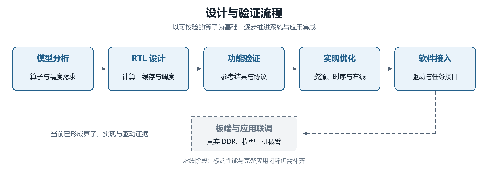

图1 作品设计与验证流程。应用闭环位于后续联调阶段。[可编辑 Draw.io 源文件](figures/01_design_flow.drawio)

# 第二部分  系统组成及功能说明

## 2.1 整体介绍

系统采用 Zynq UltraScale+ MPSoC 的 PS-PL 异构结构。PS 运行 PYNQ 与 Python 控制程序，通过 AXI-Lite 配置加速器；PL 内集成三个 GEMM 核和一个 Softmax，各算子通过 128 位 AXI 主接口访问 DDR。当前导出硬件描述显示，四个主接口经同一个 AXI SmartConnect 汇聚至 PS 的 `S_AXI_HP0_FPD`，因此各算子共享该通路和 DDR 服务带宽。[1][7][10]

在 250 MHz 时钟下，一个 128 位接口每拍传输 16 字节，理论单向数据率为 `16×250000000=4 GB/s`。四个主接口的接口侧理论值相加为 16 GB/s，但它们汇聚到同一个 HP0 和 DDR 服务路径，不能把 16 GB/s 当作系统可持续带宽；实际值还受读写仲裁、突发效率及 DDR 时序影响。

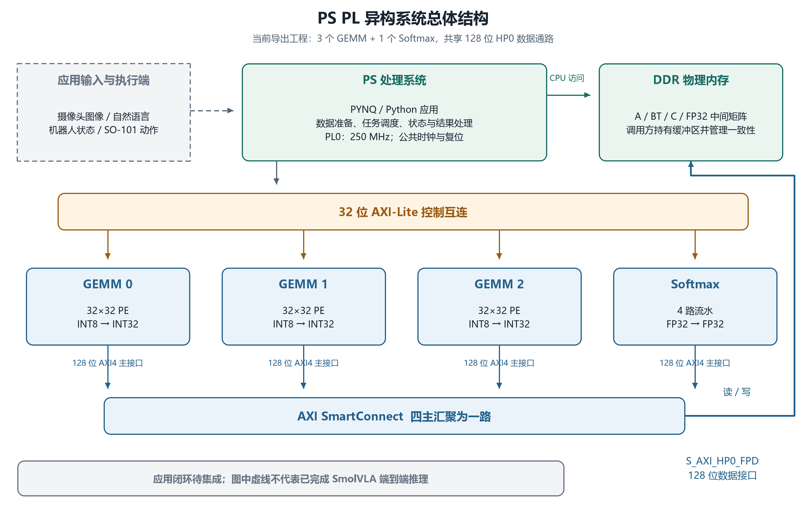

图2 系统总体框图。实线表示当前计算平台的组成关系；虚线表示计划接入的模型、摄像头和机械臂应用链路。[可编辑 Draw.io 源文件](figures/02_system_architecture.drawio)

DDR 保存输入矩阵、预转置权重、中间结果和输出。PS 将物理地址与尺寸交给算子，PL 自主完成分块、片上运算及结果写回。多核可共享只读 BT；A 和 C 按输出行范围划分，避免并发写入重叠。控制通路与数据通路在逻辑上分开，但多核并行不会自动增加物理 DDR 带宽。

作品的应用目标为“视觉感知—语言理解—动作规划—机械臂执行”。当前完成范围为算子设计、硬件集成与软件控制；模型解析、完整 Attention、LayerNorm、量化转换以及机器人动作闭环需要继续接入和验证。图中相应部分保留接口关系，不作为已完成推理链路。

## 2.2 硬件系统介绍

### 2.2.1 硬件整体介绍

硬件平台采用 `xczu15eg-ffvb1156-2-i` 器件，包含 PS、DDR、AXI 互连、三个 GEMM 核、一个 Softmax、时钟与复位逻辑。算子及互连使用 PS 输出的 PL0 时钟；当前整机实现报告给出的周期为 4 ns，即 250 MHz。

三个 GEMM 核各使用一个 128 位 AXI4 读写主接口，Softmax 也使用一个 128 位 AXI4 读写主接口。控制寄存器经 PS 的 `M_AXI_HPM0_LPD` 与 AXI-Lite 互连访问。现有部署包的控制地址见表1。

表1 当前硬件的控制地址

| 模块 | AXI-Lite 基地址 | 控制窗口大小 | 主要配置 |
|---|---|---:|---|
| GEMM 0 | `0x80000000` | 512 B | A/BT/C 地址、M/N/K、启动与状态 |
| GEMM 1 | `0x80001000` | 512 B | 同 GEMM 0 |
| GEMM 2 | `0x80002000` | 512 B | 同 GEMM 0 |
| Softmax | `0x90000000` | 512 B | 输入/输出地址、行数、行长、启动与状态 |

硬件描述中的各算子 DDR 可访问范围为 `0x00000000～0x7FFFFFFF`。该范围描述 AXI 地址映射，不代表应用拥有整段内存。软件必须使用实际申请或预留、能够被 PL 访问的物理内存；任务完成前保持其有效，并正确处理 CPU 缓存一致性。旧版固定 CMA 窗口方案与当前接收外部物理地址的驱动分别管理，不能直接混用地址假设。

### 2.2.2 机械设计介绍

应用端拟采用现成的 SO-101 机械臂，本作品的自主设计重点为 FPGA 计算平台及其控制软件。机械部分主要涉及机械臂底座、摄像头安装、工作空间布置和线缆固定，不将现成机械臂本体列为自研机构。

整体布置需要保证摄像头覆盖末端执行器和目标物体区域，机械臂动作范围与板卡、供电及通信线缆保持安全距离。图像采集、关节状态读取与动作发送由应用软件组织，具体安装尺寸、通信接线与动作约束以实物联调结果为准。

> 待补实物或工程截图：SO-101、摄像头与 ZU15EG 的整体安装图或实际布置图，标注视野、工作区、供电和通信关系。
>
> 待补实物或工程截图：摄像头支架、机械臂底座与线缆固定的局部图；尚未制作的结构不填虚构尺寸。

### 2.2.3 电路各模块介绍

**（1）GEMM 顶层结构与三核总线连接**

每个 GEMM 核以 `gemm_accelerator_top` 为顶层，包含 AXI-Lite 寄存器模块 `gemm_axil_regs`、任务与缓存控制模块 `gemm_core`、32×32 脉动阵列、A/BT/C 片上缓存、结果 Writer，以及 AXI 读写模块。三个核分别实例化上述完整结构，各自保存任务参数、缓存数据和完成状态；软件可选择一个核、两个核或三个核参与运算。[8][10]

顶层公共信号为时钟 `aclk` 和低有效复位 `aresetn`。每核向系统提供一个 32 位地址、32 位数据的 AXI4-Lite 从接口 `S_AXI`，以及一个 32 位地址、128 位数据的 AXI4 主接口 `M_AXI`。前者传递配置和状态，后者搬运矩阵数据。A、BT 的读取和 C 的写回共用该核的一个 AXI4 主接口，其中读、写通道可以独立推进。

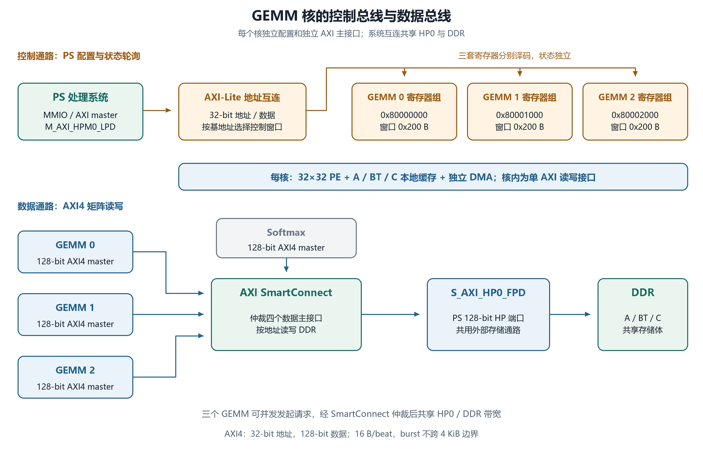

图3 GEMM 三核的控制总线和数据总线。上部为 PS 对三套寄存器的独立访问，下部为三个 GEMM 与 Softmax 共享 HP0 的数据通路。[可编辑 Draw.io 源文件](figures/06_gemm_bus_registers.drawio)

控制路径为“PS `M_AXI_HPM0_LPD`→控制互连→各核 `S_AXI`”。互连依据表1中的基地址选择目标核，例如 `0x80001004` 对应 GEMM 1 的 A 基地址寄存器。每个控制窗口在硬件地址表中分配 `0x200` 字节，当前实际有效寄存器仅为偏移 `0x00～0x50` 的 21 个 32 位字。

数据路径为“各核 `M_AXI`→AXI SmartConnect→PS `S_AXI_HP0_FPD`→DDR”。当前工程共有三个 GEMM 数据主接口和一个 Softmax 数据主接口，经互连仲裁后共享 HP0。这里的三路 GEMM 主接口分别属于三个完整计算核，每个核内仍采用单 AXI 读写架构。软件并发启动三核后，各核独立取数、计算和写回，仲裁及 DDR 服务决定实际可用带宽。

**（2）GEMM 算子与脉动阵列**

GEMM 执行 `C=A×B`。输入 A 为 M×K 的 INT8 行优先矩阵，B 预先转置为 N×K 的连续 INT8 矩阵 BT，输出 C 为 M×N 的 INT32 矩阵。转置使每个输出列所需的 K 个权重可连续读取，有利于 AXI burst 传输。M、N、K 为 32 的正倍数，当前 RTL 的 K 上限为 16352。[8]

**逐元素计算与数值范围。** 对输出位置 `(i,j)`，硬件计算 `C[i,j]=Σ A[i,k]×BT[j,k]`，求和下标为 `k=0…K−1`。每次启动从零累加，不读取旧 C，不包含偏置、激活或额外的 α、β 缩放。BT 只是 B 的存储转置，满足 `BT[j,k]=B[k,j]`，不改变乘法的数学含义。

INT8 的范围为 −128～127，单个有符号乘积的范围为 −16256～16384。PE 将 16 位乘积符号扩展到 32 位后累加。以最大合法 K=16352 估算，部分和的绝对值不超过 `16352×16384=267911168`，小于 INT32 正上限 2147483647，因此本接口范围内的原始整数点积可精确保存。该结论不包括后续另行加入偏置或缩放的运算。

例如取点积的前四项 `A=[2,−3,4,1]`、`BT=[−1,2,3,−4]`，乘积依次为 −2、−6、12、−4，部分和依次为 −2、−8、4、0。若将其作为一个合法 K=32 任务的前四项，剩余 28 项补零，最终该输出仍为 0。这个算例说明有符号乘法、符号扩展和累加顺序；实际硬件始终按完整 K 执行。

32×32 阵列包含 1024 个处理单元。每个处理单元完成一个有符号 INT8 乘法及 INT32 累加，数据通过行列方向的寄存器逐级传递。控制器负责送数、清除或回收累加状态、计算流水推进及输出上下文维护。阵列需要填充和排空，不能将所有推进周期等同于全部 PE 均执行有效乘加。

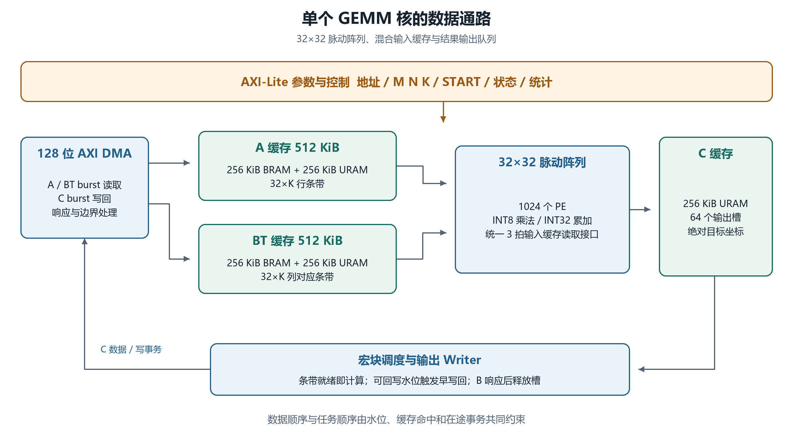

图4 单个 GEMM 核的数据通路。三个核采用相同接口；图中 A/BT 的存储与蛇形调度对应 GEMM_V2 设计。[可编辑 Draw.io 源文件](figures/03_gemm_datapath.drawio)

硬件的任务过程可按“接受参数—规划宏块—发布条带—选择输入对—阵列计算—结果退休”理解。任务开始后先锁存地址与维度，检查矩阵范围；加载器与计算状态机随后独立推进。加载器把 DDR 中的输入写进片上缓存，计算侧只使用已经发布 ready 的完整条带。结果通过独立 Writer 回到 DDR，最后等待所有输出事务排空才结束任务。

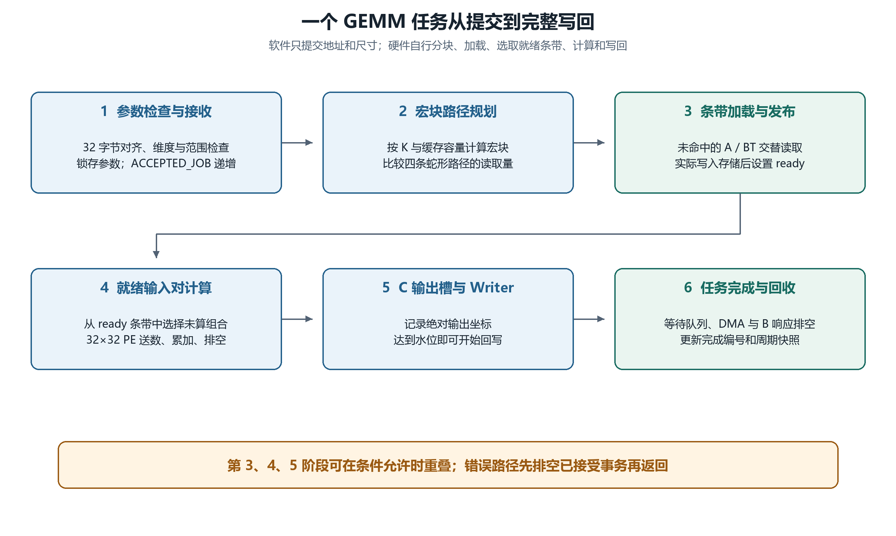

图5 一个 GEMM 任务的完整执行过程。第 3、4、5 阶段具有重叠条件，箭头表示依赖与控制顺序，不表示所有任务按六段完全串行执行。[可编辑 Draw.io 源文件](figures/09_gemm_job_pipeline.drawio)

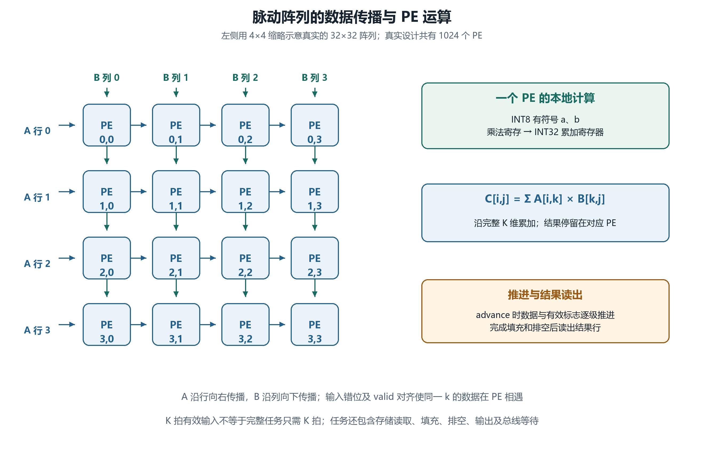

图6 用 4×4 缩略阵列说明真实 32×32 阵列的数据传播和 PE 累加过程。[可编辑 Draw.io 源文件](figures/11_systolic_pe.drawio)

以一个 32×32 输出微块为例，每次有效推进给 32 行送入 A 的一个 K 位置，并给 32 列送入 B 的对应位置。A 向右、B 向下传播，输入错位及有效标志对齐保证同一个 k 的数据在 PE 相遇。PE 保存自己的 INT32 部分和，沿 K 维累加；阵列还需要填充和排空，结果按行读出。当前设计对局部控制信号进行寄存，减轻全阵列控制扇出；流程图不用于推出固定的首结果时刻。

每个输出微块为 32×32。宏块最多覆盖 256 行 A 和 256 行 BT，其行数还受到 K 和 512 KiB 输入缓存容量的限制。装入宏块的数据被多个输出微块复用，避免每个微块都重新读取全部输入。任意一对完整 32×K 条带写入缓存后，即可开始对应计算，其余条带继续后台加载。

**微块内部的运算与送数。** 设微块左上角为 `(m0,n0)`，局部 PE 坐标为 `(r,c)`，则该 PE 保存 `Σ A[m0+r,k]×BT[n0+c,k]`，其中 `0≤r,c<32`。一个微块执行 `32×32×K=1024K` 次有效 MAC；完整矩阵执行 `MNK` 次 MAC。若一次乘法和一次加法各算一次操作，运算量为 `2MNK`，不应再把 1024 个 PE 的并行度重复乘入总运算量。

片上缓存按行存储，而阵列需要同一 k 的 32 个 A 和 32 个 BT。`gemm_input_stream256` 依次读取各行的 32 字节片段，将返回数据放入各 lane 的字节队列，再每次推进弹出一个字节。每个操作数缓存只有一个 256 位读口，每拍最多返回 32 字节；通过分行预取和错位启动，连续阶段可各形成 32 个 INT8 的阵列边界向量。这里不需要同时读取 32 个独立 RAM 端口；A 向右、BT 向下的传播继续完成阵列内部复用。

PE 的乘法结果先进入 16 位寄存器，下一次有效推进再累加到 INT32 部分和；停顿时乘法、累加和有效标志一同保持。对 N=32 的基础阵列，最后一组有效输入之后还需 `2N−1=63` 次推进排空传播和乘法流水。当前顶层还包含输入错位、局部控制寄存及收尾时序，其计算计数对完整微块为 `K+67` 拍。该数值是阵列推进计数，未覆盖微块清零、读缓存启动、结果队列等待和最终 DDR 写回，不能直接用它替代任务周期。

**由容量确定宏块。** 令单个输入缓存容量 `S=524288` 字节，允许的宏条带行数为 `R=min(256,32×floor(S/(32K)))`，随后取 `T_M=min(M,R)`、`T_N=min(N,R)`。向下取整保证整个条带容纳在一个输入缓存中，32 对齐保证可分成完整微块；A 和 BT 分别核算容量。输出微块总数为 `(M/32)×(N/32)`。

| K | 一个 32×K 条带 | 最大宏条带行数 R | 满宏条带所占容量 |
|---:|---:|---:|---:|
| 2048 | 64 KiB | 256 | 512 KiB |
| 2336 | 73 KiB | 224 | 511 KiB |
| 4096 | 128 KiB | 128 | 512 KiB |
| 8192 | 256 KiB | 64 | 512 KiB |
| 16352 | 511 KiB | 32 | 511 KiB |

例如 K=4096 时，宏块最多为 128×128，内部包含 4×4=16 个输出微块；K=16352 时只保留一条 A 和一条 BT，宏块退化为一个 32×32 微块。当前设计在每个微块内完成完整 K 维点积，不把不同 K 分段产生的部分和送到 CPU 合并。

**（3）混合 BRAM/URAM 输入缓存与结果缓存**

A 和 BT 各使用 512 KiB 有效缓存，每个缓存的前 256 KiB 映射到 BRAM，后 256 KiB 映射到 URAM。按有效字节容量各占一半，不要求两类原语数量相同。两种存储统一为 3 拍读取接口，以保证跨 bank 及半区切换时的数据、地址和有效标志对齐。[3][8]

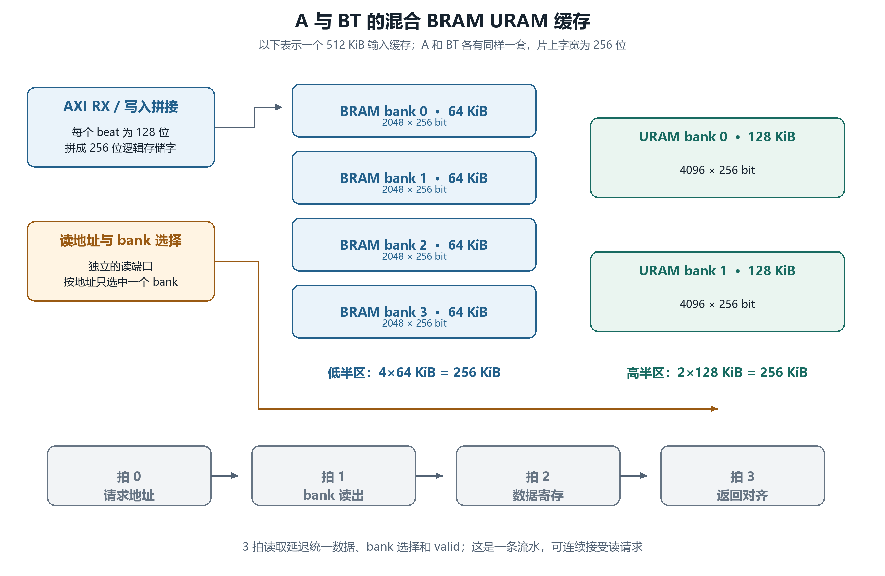

图7 一个输入缓存的 bank 组织和统一读取延迟。A 与 BT 各实例化同样的缓存。[可编辑 Draw.io 源文件](figures/10_cache_banks.drawio)

每个输入缓存的低半区由四个 2048×256 位 BRAM bank 构成，高半区由两个 4096×256 位 URAM bank 构成。两类存储都通过地址寄存、存储输出及返回对齐形成统一接口；bank 选择与 valid 一同延迟，避免读跨半区时返回旧 bank 的数据。片上读端口和加载写端口相互独立，只要不覆盖仍有用的数据，输入加载就可以与阵列读取重叠。

表2 单个 GEMM 核的片上缓存

| 缓存 | 有效容量 | 存储组成 | 作用 |
|---|---:|---|---|
| A | 512 KiB | 256 KiB BRAM＋256 KiB URAM | 缓存输入行条带 |
| BT | 512 KiB | 256 KiB BRAM＋256 KiB URAM | 缓存预转置权重条带 |
| C | 256 KiB | URAM | 保存 64 个 32×32 INT32 输出槽 |

C 缓存由环形槽和输出上下文共同管理。上下文保存目标矩阵的绝对坐标，宏块切换不会改变在途结果的输出地址。槽在写数据及相应 AXI B 响应完成后释放。槽满时计算等待，加载和回写可继续；整个任务仅在所有结果与写响应排空后报告完成。

**缓存容量与地址换算。** 一个 256 位字为 32 字节，所以每个输入缓存深度为 `524288/32=16384` 字，字地址为 14 位。低半区容量为 `4×2048×256/8=262144` 字节，高半区为 `2×4096×256/8=262144` 字节。bank 是同一个逻辑地址空间的分段，并不会把外部 AXI 读带宽扩大六倍。

对某个已经加载的宏条带，局部第 r 行、第 k 个字节对应字地址 `floor((rK+k)/32)`，字内偏移为 `k mod 32`。字地址 bit13=0 时选择 BRAM，bits[12:11] 选择四个 bank、bits[10:0] 为 bank 内地址；bit13=1 时选择 URAM，bit12 选择两个 bank、bits[11:0] 为 bank 内地址。相同的地址规则用于 A 和 BT。

C 的一个输出槽为 `32×32×4=4096` 字节，512 位结果字每次保存 16 个 INT32，因此一个槽为 64 个结果字；`64×4096=262144` 字节形成 256 KiB 结果缓存。64 个槽表示最多保留 64 个尚未退休的输出微块，是否可接收下一结果还取决于上下文队列和写回水位。

**（4）蛇形遍历与访存复用**

蛇形遍历针对的是输出宏块的执行顺序，其依据是相邻任务能否继续使用片上已有的输入。常规逐行宏块遍历在行末跳回首列时，上一块 BT 通常无法继续利用。蛇形遍历使相邻宏块行反向移动：同一宏块行内复用 A，行末转向后的首块复用刚才的 BT，从而减少重新装载。下面用一个单核、冷缓存、无尾块的具体矩阵说明。

设 `A[768,2048] × B[2048,768] = C[768,768]`，输入 A/B 为 INT8，输出 C 为 INT32。K=2048 时，512 KiB 输入缓存能容纳 `524288/2048=256` 行，因此 M、N 方向均以 256 为宏块跨度，各分为 3 组。

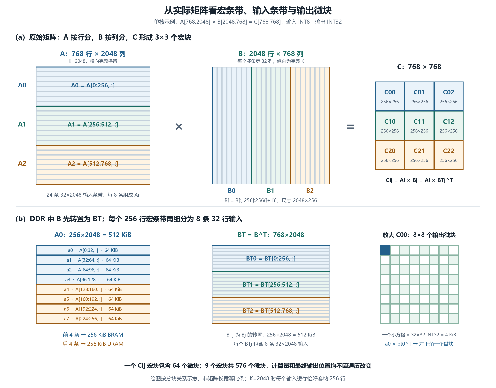

图8 实际矩阵的分块层级。A 按行分为 A0～A2，B 按列分为 B0～B2；软件将 B 转置为 BT，使每个 B 列条带对应连续的 BT 行条带。细线表示 32 行或列条带，粗线表示 256 行或列宏条带；右下角放大一个 C 宏块中的 64 个输出微块。图中尺寸为元素数量，绘图长宽不按比例。[可编辑 Draw.io 源文件](figures/04_matrix_strips.drawio)

三类分块的具体含义如下。

| 层级 | 本例中的矩阵范围与尺寸 | 用途 |
|---|---|---|
| A 宏条带 | `Ai=A[256i:256(i+1), :]`，256×2048，共 512 KiB | 一个 Ai 与不同 Bj 相乘，得到 C 的一整行宏块 |
| B 宏条带 | `Bj=B[:, 256j:256(j+1)]`，2048×256 | 对应输出 C 的一个 256 列范围 |
| BT 宏条带 | `BTj=BT[256j:256(j+1), :]=Bjᵀ`，256×2048，共 512 KiB | 以连续行布局从 DDR 加载，供阵列读取 |
| 32 行输入条带 | A 或 BT 的 32×2048，共 64 KiB；每个宏条带包含 8 条 | 条带完整写入片上缓存后，即可参与微块计算 |
| C 宏块 | `Cij=C[256i:256(i+1), 256j:256(j+1)]`，256×256，共 256 KiB | 等于 `Ai×Bj`，也等于 `Ai×BTjᵀ` |
| C 微块 | 32×32 INT32，共 4 KiB；每个 Cij 包含 8×8=64 个 | 对应一次脉动阵列的完整输出微块 |

如图8 所示，一个输入宏条带的 8 条小条带占满 512 KiB 缓存，前 4 条位于 256 KiB BRAM，后 4 条位于 256 KiB URAM。这里“32 行就绪”指连续的 `32×K` 数据已经实际写入缓存；计算一个输出微块需要一条 A 条带和一条 BT 条带都就绪。例如 `a0=A[0:32,:]` 与 `bt0=BT[0:32,:]` 相乘，得到 `C[0:32,0:32]`；其他已就绪的条带对也可继续参与计算。

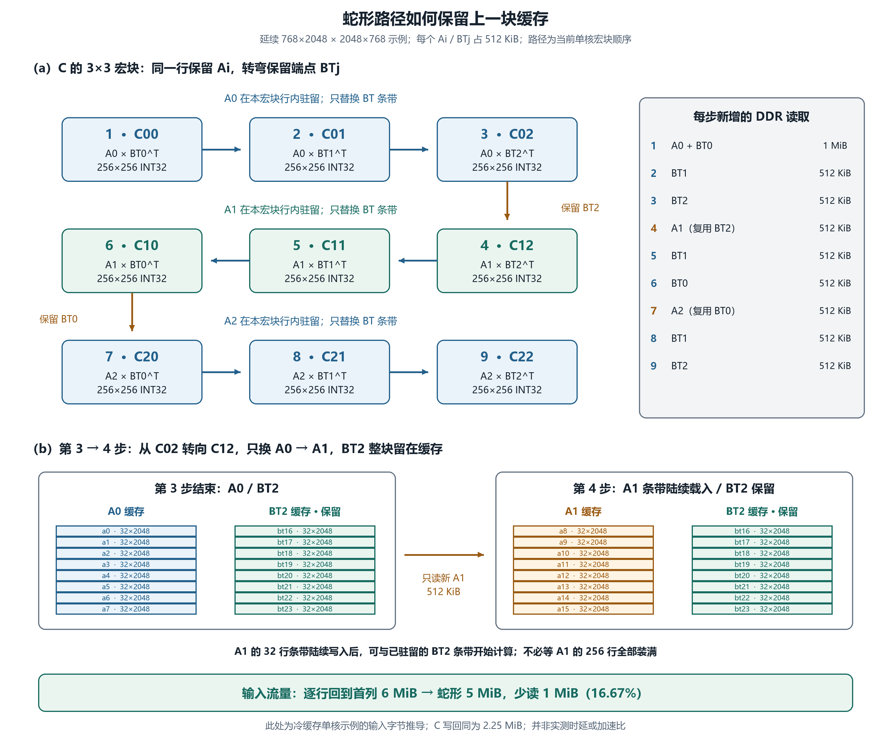

图9 同一矩阵的行方向蛇形路径、每步新增读取以及转弯前后的片上缓存状态。编号 1～9 为宏块执行顺序；橙色箭头表示跨宏块行时复用 BT 端点。图下方展示 C02→C12 时保留完整 BT2，只将 A0 替换为 A1。[可编辑 Draw.io 源文件](figures/04_snake_schedule.drawio)

本例的输出宏块按下列顺序执行，输入在 DDR 中的元素顺序不变：

```text
第 0 宏块行：C00 → C01 → C02       A0 驻留，依次使用 BT0、BT1、BT2
                            ↓     保留 BT2，仅加载新的 A1
第 1 宏块行：C10 ← C11 ← C12       A1 驻留，依次使用 BT2、BT1、BT0
             ↓                    保留 BT0，仅加载新的 A2
第 2 宏块行：C20 → C21 → C22       A2 驻留，依次使用 BT0、BT1、BT2
```

首次计算 C00 需要读入 A0 和 BT0；转到 C01、C02 时 A0 命中，只加载新 BT。由 C02 转到 C12 时，BT2 的标签和数据仍有效，加载器只需将 A 缓存更新为 A1。A1 的一条 32 行数据完整写入后，就能与已驻留的 BT2 条带组成可计算的输入对，其余 A1 条带可继续加载。随后向左计算 C11、C10；再向下转到 C20 时，保留 BT0，只更新 A2。每个宏块内仍会产生多个微块，图9 的九次访问表示宏块顺序，不表示只有九次阵列计算。

若以“每行都从 C 的首列重新开始、行内保留 A”的方式作对照，三条 A 宏条带各读一次，共 1.5 MiB；每行都重新读 BT0、BT1、BT2，三行共读 9 个 BT 宏条带，即 4.5 MiB，合计输入读取 6 MiB。蛇形遍历仍读 3 个 A 宏条带，但 BT 在两次转弯处各保留一次，只需读 `3+2+2=7` 个 BT 宏条带，即 3.5 MiB，合计输入读取 5 MiB。本例因此少读 1 MiB，输入流量减少约 16.67%；C 的 2.25 MiB 输出和有效乘加次数保持相同。该数字是分块与命中关系的字节推导，并非板端测速；由于加载与计算重叠，总周期降幅通常小于输入流量降幅。

对于各宏块均完整的 P×Q 输出宏块网格，行蛇形比同样保留行内 A 的逐行遍历少加载 `P−1` 个 BT 宏条带，即每次换宏块行省一次端点重读。若宏块数量、形状或尾块尺寸改变，应按实际条带字节重新计算；当输出只有一个宏块行时，不存在换行端点复用收益。

硬件在任务开始时比较行正向、行反向、列正向、列反向四种候选路径的输入读取量，并考虑不满宏块的尾部尺寸。相同读取量时选择行蛇形。规划采用多拍移位加法和恢复除法，避免在关键路径中引入可变组合乘除法。缓存命中可跳过相应条带加载，但不会改变最终输出矩阵的排列。

**包含尾块的路径代价。** 设宏条带常规跨度为 `u=T_M`、`v=T_N`，宏块行数为 `P=ceil(M/u)`、列数为 `Q=ceil(N/v)`，末条带实际行数为 `a=M−(P−1)u`、`b=N−(Q−1)v`。以下按一个任务冷缓存、A/BT 各只保留当前宏条带计算输入读取量，不含 C 写出。

行蛇形中 A 总共读取 M 行，BT 首个宏块行读取 N 行；此后每转弯一次，省去一个端点 BT 条带。`P−1` 次转弯在完整端点 v 和尾端点 b 之间交替。当 P 为偶数且 b<v 时，从尾列开始反向移动可以多保留一次较大的完整端点。因此，两个行方向中的最小读取量，以及两个列方向中的最小读取量分别为：

```text
L_row = M + P×N − floor(P/2)×v − floor((P−1)/2)×b
L_col = N + Q×M − floor(Q/2)×u − floor((Q−1)/2)×a
输入读取字节 D_in = K × min(L_row, L_col)
输出写入字节 D_out = 4×M×N
```

L 的单位是输入矩阵的“行数”；A 和 BT 每行都为 K 个 INT8，共 K 字节，所以两个方向比较时可省去公共乘数 K。规划器通过 16 拍恢复除法取得条带个数与余数，再通过多拍移位加法求代价和地址步长，最后选择方向。尾块改变的是有效行数及地址，微块仍保持 32×32。

以表9 的 288×288、K=2048 用例为例，`u=v=256`、`P=Q=2`、`a=b=32`。逐行保留 A 的对照流量为 `(288+2×288)×2048=1769472` 字节，即 1.6875 MiB；优化方向得到 `L_row=288+2×288−256=608` 行，读取 `608×2048=1245184` 字节，即 1.1875 MiB。若从首列开始，转弯只能保留 32 行尾块；选择反向起点可保留 256 行完整条带，从而少读 0.5 MiB，降幅为 `0.5/1.6875=29.63%`。

对于 M=2048、N=512、K=2048，`P=8`、`Q=2`，端点均为 256 行。对照读取 `(2048+8×512)×2048=12 MiB`；蛇形路径得到 `L_row=2048+8×512−(4+3)×256=4352` 行，读取 8.5 MiB，恰好少读七个 512 KiB 端点条带。这一推导与表9 的读字节计数对应。

蛇形遍历主要作用于宏块顺序；宏块内部仍由完整条带就绪情况、读引擎状态及计算状态共同控制。它不意味着单 AXI 同拍传输 A 和 BT，也不意味着任意重排所有微块。当前读引擎优先交替加载尚未命中的 A/BT 条带，在数据就绪后启动计算。

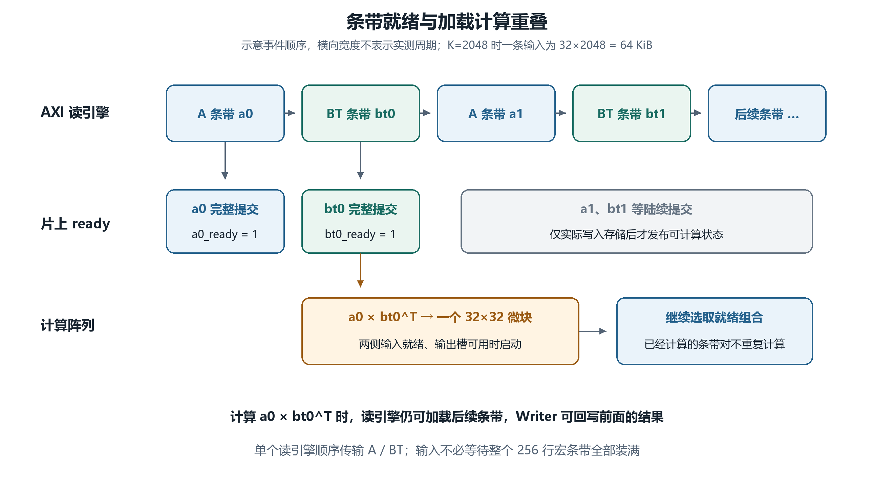

图10 条带加载、实际提交、ready 发布与计算重叠的事件关系。图中位置表示先后依赖，非实测波形。[可编辑 Draw.io 源文件](figures/12_strip_ready_overlap.drawio)

微块调度并不强制等待某一个固定的下一块。硬件结合 A 就绪位、BT 就绪位和未计算组合位图，从可用条带对中选择输入。这样，先到达的一组输入可先计算；若对应输出槽不可用，仍要等待 Writer 释放空间。该机制提高数据到达后的可用性，同时不改变宏块的蛇形路径和 C 的绝对输出坐标。

**（5）加载、计算和结果回写重叠**

当前调度在结果达到可读取水位后尽早启动 C 回写，不等待整个宏块的 A/BT 全部加载。宏块计算和输入写入流水排空后，即可推进下一宏块，上一宏块尚未退休的 C 由输出队列继续回写。该机制利用 AXI 独立读写通道，减少串行等待。

这种方式是基于缓存所有权、水位与队列的流水调度，不能简单等同于对全部 A、B、C 各配置两套完整 Ping-Pong 缓存。数据是否允许覆盖，由对应地址是否已经安全读出、输出槽是否释放以及相关事务是否完成决定。

写 DMA 提前寄存下一行首地址，拆分页内地址和页号更新，并缩短 burst 长度比较路径，降低地址生成逻辑延迟。该修改保留 burst、跨页拆分及在途事务语义，不通过给每笔 burst 增加等待状态来换取时序。

**（6）AXI4 数据接口与 DMA 传输组织**

数据接口由 `gemm_axi_duplex128` 组织独立的读、写命令通路，内部各使用一个 `gemm_axi_dma128` 引擎。每个方向同一时刻处理一个 DMA 命令，并分别保留最多两笔 burst 的在途容量，采用相同 ID 的有序响应。由此可以在读输入时写输出，也可以用下一笔地址请求覆盖前一笔传输的部分等待时间；一个读引擎中的 A 和 BT 仍按命令交替传输。

每个 AXI beat 为 128 位，即 16 字节，可承载 16 个 INT8 输入或 4 个 INT32 输出。接口采用递增地址 burst，`ARSIZE/AWSIZE=4`，`ARLEN/AWLEN` 编码为实际 beat 数减一，当前 `MAX_BURST=256`。每笔 burst 长度同时受剩余数据、256 beat 上限、4 KiB 页边界，以及输出行边界限制。256 beat 是允许上限，实际传输会因矩阵布局和边界而缩短。[4][8]

A 或 BT 的一条 32×K 输入条带占 `32×K` 字节，读引擎将连续地址拆成若干 burst。以 K=2048 为例，一条带为 64 KiB，起始地址按 4 KiB 对齐时可拆成 16 笔、每笔 256 beat 的读取。收到的 128 位数据经拼接和寄存后写入片上缓存；只有全部条带数据实际写入存储，才发布该条带的就绪标志，避免仅凭 DMA 接收完成就提前读缓存。

C 的一个 32×32 INT32 微块占 4096 字节，但在完整 M×N 行优先矩阵中，每一输出行只占连续的 `32×4=128` 字节，相邻行首地址相差 `N×4` 字节。Writer 因此提交带行跨度的写命令：共写 32 行，每行通常为 8 beat，行内连续传输，行末跳转到下一行地址。遇到 4 KiB 页边界还会拆分为更短 burst。这解释了 C 的常见 burst 为 8 beat，而输入读取可达到 256 beat；不能仅依据写 burst 较短判断带宽未被利用。

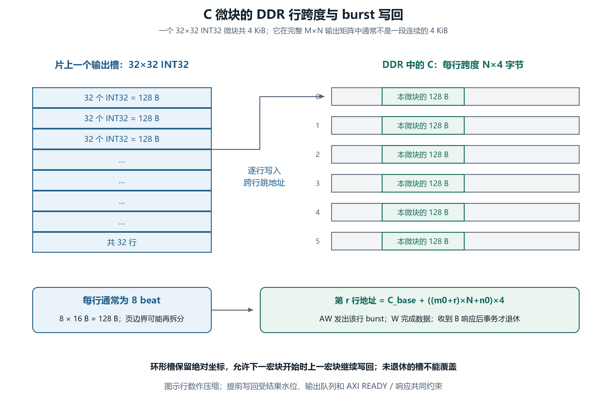

图11 C 输出微块的行跨度、burst 与响应退休。左侧为片上紧凑输出槽，右侧为完整输出矩阵中的目标行区间。[可编辑 Draw.io 源文件](figures/13_c_writeback.drawio)

Writer 的上下文包含输出微块的绝对起始行列和任务关联信息，因此宏块调度推进后，旧结果仍能写入原来的位置。某微块的第 r 行地址为 `C_base+((m0+r)×N+n0)×4`。一个槽不是 WLAST 发出就立即可覆盖，必须等该输出的写命令及相关响应完成；只有整个任务所有上下文退休，软件才可以把 C 当作完整矩阵读取。

**地址与 burst 长度的计算。** 行优先布局下，三个元素的字节地址分别为 `A_base+iK+k`、`BT_base+jK+k` 和 `C_base+4(iN+j)`。对当前 16 字节对齐地址 addr，距本页末尾还可传输 `B_page=(4096−(addr mod 4096))/16` 个 beat。DMA 将 burst 长度限制为剩余 beat、256、B_page，以及跨行模式下本行剩余 beat 四者的最小值，并把长度减一写入 AxLEN。

例如 addr 的页内偏移为 `0xFF0`，本页仅剩 16 字节，当前 burst 只能为 1 beat，AxLEN=0；下一 burst 从新页开始。对 N=512、微块起点 `(m0,n0)=(32,64)`，C 的首行起始偏移为 `4×(32×512+64)=65792` 字节，第二行比它增加 `4×512=2048` 字节。每行写 128 字节、共 8 beat；一个微块合计 256 个 W beat。在不额外跨页拆分时，对应 32 笔写 burst，而非一笔连续的 4 KiB 写入。

读方向检查 `RID`、`RRESP` 和 `RLAST`，写方向检查 `BID`、`BRESP`。VALID 发出后若 READY 为低，地址或数据须保持稳定。最后一拍 W 数据被接受后，写命令仍需等待对应 B 响应；输出槽也必须在相关事务退休后才能复用。发生错误时停止分配新 burst，保留并排空已经承诺的地址、数据和响应，随后报告任务异常。

**（7）AXI-Lite 寄存器与任务完成语义**

寄存器模块分别锁存 AW 地址和 W 数据，允许两个写通道先后到达；收到配对信息后执行地址译码、字节使能合并与合法性检查，再返回 B 响应。读通道锁存 AR 请求并返回 R 数据，读写响应均保持到 PS 接受。所有有效寄存器按 4 字节对齐；非有效地址访问、写只读寄存器及不允许的配置写入返回 `SLVERR`。计算忙时不允许改写矩阵地址和维度，防止在途任务的配置被覆盖。

表3 GEMM 每核 AXI-Lite 寄存器映射，地址为控制基地址加表内偏移

| 偏移 | 名称 | 访问属性 | 功能与编码 |
|---|---|---|---|
| `0x00` | `CTRL` | RW／写脉冲 | bit0：ENABLE；bit1：IRQ_ENABLE；bit8：START；bit9：CLEAR_STATUS |
| `0x04` | `A_BASE` | RW | 连续 INT8 A 的 DDR 物理基地址 |
| `0x08` | `BT_BASE` | RW | 连续 INT8 BT 的 DDR 物理基地址 |
| `0x0C` | `Y_BASE` / `C_BASE` | RW | INT32 输出 C 的 DDR 物理基地址 |
| `0x10` | `DIM_MN` | RW | `[15:0]=M/32`，`[31:16]=N/32` |
| `0x14` | `DIM_K` | RW | `[15:0]=K/32`，高 16 位必须为 0 |
| `0x18` | `FLAGS` | RO | 忙、完成、错误、计数饱和与 writer 状态，含有效分块尺寸 |
| `0x1C` | `TILES_DONE` | RO | 已完成回写并退休的输出微块数 |
| `0x20` | `ACCEPTED_JOB` | RO | 最近接受的任务编号 |
| `0x24` | `COMPUTE_DONE_JOB` | RO | 记录完成任务编号；当前与最终写回完成一起更新 |
| `0x28` | `WRITE_DONE_JOB` | RO | 所有输出及写响应完成的任务编号 |
| `0x2C` | `WRITER_JOB` | RO | Writer 当前处理的任务编号 |
| `0x30` | `WRITER_MASKS` | RO | 保留的 Writer 掩码接口，当前实现返回 0 |
| `0x34` | `CYCLES_LO` | RO | 64 位任务总周期低 32 位 |
| `0x38` | `CYCLES_HI` | RO | 64 位任务总周期高 32 位 |
| `0x3C` | `COMPUTE_CYCLES` | RO | 阵列推进周期，包含填充和排空 |
| `0x40` | `LOAD_CYCLES` | RO | 输入加载状态机活跃周期，包含等待 |
| `0x44` | `STORE_CYCLES` | RO | Writer 活跃周期，包含队列与总线等待 |
| `0x48` | `READ_BYTES` | RO | AXI R 握手成功的 beat 数乘以 16 |
| `0x4C` | `WRITE_BYTES` | RO | AXI W 握手成功的 beat 数乘以 16 |
| `0x50` | `CAP_CONFIG` | RO | 当前 ABI 能力签名 `0x0A080020` |

`CTRL` 的 ENABLE、IRQ_ENABLE 为保持位，START、CLEAR_STATUS 为写入触发的单拍命令，读回 CTRL 只得到低两位。普通启动写入 `ENABLE | START = 0x101`；清旧状态和累计流量写入 `ENABLE | CLEAR_STATUS = 0x201`。START 需要使能有效、核心可接受新任务且无未清错误，不允许与 CLEAR_STATUS 同次触发。当前顶层未将内部 `irq` 引出，驱动使用轮询；IRQ_ENABLE 字段保留在寄存器 ABI 中。

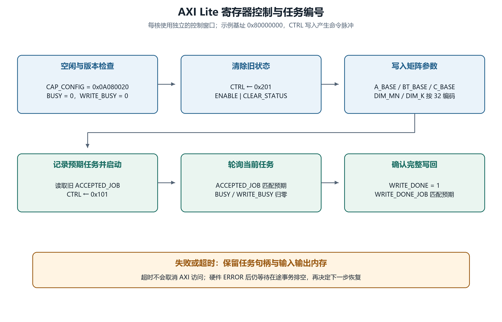

图12 一核 GEMM 的寄存器操作与任务编号核对顺序。三个核使用各自控制窗口独立执行同样的过程。[可编辑 Draw.io 源文件](figures/14_axil_job_sequence.drawio)

`FLAGS` 的 bit0 为 BUSY，bit1 为 COMPUTE_DONE，bit2 为 ERROR，bit4 为 PERF_SAT，bit6 为 WRITE_BUSY，bit7 为 WRITE_DONE；`[11:8]`、`[15:12]`、`[24:16]` 分别给出当前有效分块的 M/32、N/32、K/32，其余位保留。当前控制器先等待输出队列和 writer 排空，再进入最终完成状态，因此 COMPUTE_DONE 与两个完成任务编号在任务收尾时更新；不能把 COMPUTE_DONE 当作可提前覆盖输入或启动下一任务的独立通知。

以一个核执行 M=704、N=512、K=2048 为例，软件向 `DIM_MN` 写入 `0x00100016`，向 `DIM_K` 写入 `0x00000040`，而不是直接写原始行列数。参数检查保证 M、N、K 为 32 的正倍数，M/N 不超过 2097120，K 不超过 16352，并检查地址对齐、范围和输出冲突。硬件接受 START 后递增 `ACCEPTED_JOB`，驱动记录预期编号，待 BUSY、WRITE_BUSY 清零，WRITE_DONE 有效且 `WRITE_DONE_JOB` 与预期编号相同后，才回收任务。

任务总周期及计算、加载周期在任务结束时形成快照，64 位总周期可由高低字拼接。读写字节和 writer 活跃周期由 CLEAR_STATUS 清零，驱动在每次任务前执行该操作。32 位活动周期与流量计数采用饱和计数，出现 PERF_SAT 时相应统计不能继续用于精确性能计算。通过 `字节数/(总周期/时钟频率)` 可得任务平均带宽；活动周期相互重叠，不能相加，也不能将 STORE_CYCLES 当成 W 通道每拍均有效的证据。

**（8）Softmax 算子与四路 FP32 流水**

Softmax 对输入矩阵的每一行独立执行稳定归一化。先求该行最大值 m，再计算 `e[i]=exp(x[i]−m)`，最后计算 `p[i]=e[i]/Σe[j]`。减去最大值在精确数学下不改变结果，并有助于避免正指数溢出。[2][9]

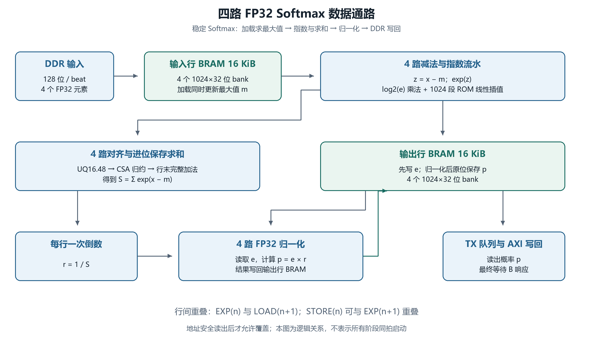

图13 Softmax 的四阶段数据通路。输入、输出行缓存各为 16 KiB，均由四个 FP32 bank 构成。[可编辑 Draw.io 源文件](figures/05_softmax_datapath.drawio)

Softmax 支持 1≤M≤65536、1≤K≤4096。每个 128 位 AXI beat 容纳四个 FP32 元素。加载阶段同步求最大值；指数阶段四路减法和指数运算并行，结果写入输出缓存，同时进入求和通路；归一化阶段每行计算一次倒数，以四路乘法获得概率；最后从输出缓存写回 DDR。

指数单元采用乘以 log2(e)、1024 段整数 ROM 与线性插值实现近似计算。求和阶段将指数值对齐至 UQ16.48，以进位保存结构进行归约，行末再完成进位加法并转换为 FP32。该过程避免每个周期在反馈路径中串联完整浮点求和链，但引入了近似及归约顺序差异，需要通过数值误差测试评价。

**加载与最大值计算。** 对一行 K 个元素，需要 `W=ceil(K/4)` 个 128 位字。每次接收四个元素，先按 DAZ 将非正规数视为带符号零，再把 FP32 转成可排序整数 key：非负数使用 `{1,x[30:0]}`，负数使用逐位取反 `~x`。对该 key 做无符号比较即可维持浮点大小顺序，避免在反馈通路中串联通用浮点减法。

四条 lane 分别更新自己的历史最大值，再两两合并并作最终比较。路径由 key 捕获、lane 更新、两两合并和最终合并四级组成。无效尾 lane 和 −inf mask 不计入有效数据；NaN、+inf 单独检测。最后一个输入字接收后，还须等待最大值流水和 DMA 排空，才能锁存本行 m。计算中的 m 与下一行加载的最大值分开保存，预取不会改变当前归一化基准。

**减法与指数近似。** 有限输入先求 `z=x−m≤0`，再取 `d=abs(z)`，计算 `t=d×log2(e)`，其中 FP32 常数为 `0x3FB8AA3B`，约 1.442695。于是 `exp(z)=2^(−t)`。将 t 分成整数 n 与小数 f，即 `t=n+f`、`0≤f<1`；整数部分通过调整 FP32 指数实现，小数部分由 ROM 插值求出。

ROM 把 [0,1] 等分为 1024 段，段号 `j=floor(1024f)` 占 10 位。每段保存起点 `base[j]=RNE(2^(−j/1024)×2^30)` 和相邻差 `drop[j]=base[j]−base[j+1]`。RNE 表示舍入到最近值，恰好居中时取偶数。源表共 1024×64 位，即 8 KiB；四路查询采用两份双读表，共 16 KiB 的 ROM 数据容量。

范围转换得到 23 位小数后，最高 10 位选段，余下 13 位作为段内位置 h。后端按以下整数过程插值，再规格化并舍入打包成 FP32：

```text
h = floor((1024f−j)×8192)          # 0…8191
q = base[j] − RNE(drop[j]×h/8192) # q 的比例因子为 2^30
e ≈ (q/2^30) × 2^(−n)
```

例如 z=−1 时，`t≈1.442695`、n=1、j=453，插值得到的结果接近 `exp(−1)≈0.367879`。完整运算还包括 FP32 减法和乘法舍入、定点截断、插值舍入及最终 FP32 打包，因此不能把理想实数插值直接视为逐位参考。硬件也处理极小指数的 FTZ 和极端差值的范围保护，避免指数截断后环绕。

本实现的减法为 10 级、乘 log2(e) 为 8 级、插值及打包为 9 级，总计 27 级无停顿流水深度；持续输入时每拍可接收一组四个元素。每路插值乘法使用 20 位 drop 与 13 位 h 相乘；最大 drop=726572 可容纳于 20 位。FP32 尾数的 24×24 乘法拆为 24×17 和 24×7 两个部分积后合并。27 级描述首结果延迟，四路描述每次接收的元素数，二者分别决定延迟与吞吐。

**定点求和与进位保存。** 对正常 FP32 指数结果，若 E 是带偏置指数、F 是包含隐藏位的 24 位尾数，则 `e=F×2^(E−150)`。求和分支将它转换为 `q=RNE(e×2^48)=RNE(F×2^(E−102))`；零、mask 和无效 lane 对应 q=0。这样，同一行所有 e 被对齐到具有 48 位小数的统一 64 位格式。

四个 q 先压缩为两个数 U、V，再和前一拍保存的两个数 A、B 压缩为新的 A、B；A、B 是累加状态，与 GEMM 的输入矩阵无关。3:2 压缩的基本关系为 `sum=a XOR b XOR c`、`carry=((a AND b) OR (a AND c) OR (b AND c))<<1`，且 `a+b+c=sum+carry`。反馈中只保留两个数，行末才计算完整进位和 `T=A+B`，随后转换为 `S=FP32(T×2^−48)`。

定点转换为 4 级，前向和反馈压缩各 1 级；最后一组输入被接受到整数行和有效间隔为 6 拍，随后用 5 级完成行和转 FP32。正常有效行至少有一个最大元素，其指数为 1；K≤4096 时，`1≤S≤4096`，对应整数总和 `T≤4096×2^48=2^60`，64 位累加足够。仅入口定点化产生的累计绝对误差不超过 `K×2^−49`，K=4096 时约 `7.28×10^−12`；指数近似和 FP32 舍入误差须另外评价。

**每行倒数与四路归一化。** 行和 S 就绪后，每行只求一次 `r=RNE_FP32(1/S)`，再通过 8 级四路浮点乘法计算 `p[i]=RNE_FP32(e[i]×r)`。一般倒数把有效尾数作为 24 位除数，逐位移入被除数并比较减法余数，以 48 次恢复除法迭代产生商和余数，再分别完成余数比较、RNE 和 FP32 打包，各占 1 拍。若两倍余数大于除数则向上舍入，等于除数时依据商的最低位取偶数。S 为 2 的整数次幂时，调整指数即可精确求倒数，走 1 级旁路。

因此硬件执行 K 次指数运算、一次倒数和 K 次归一化乘法。倒数与乘法分别舍入，结果可能与逐元素直接执行 FP32 除法略有不同。输出 e 在本行归一化前仍以 FP32 存在输出缓存中，UQ16.48 只用于行和支路，不会把输出概率直接作为定点数据写回。

**一行的数值例子。** 取理想输入 `[2,2+ln(0.75),2+ln(0.5),2+ln(0.25)]`，约为 `[2,1.712318,1.306853,0.613706]`。各阶段计算如下，表中数值为实数算例；实际 FP32 输入和硬件近似会引入舍入差异。

| 阶段 | 四个元素或行标量 |
|---|---|
| 最大值 | m=2 |
| 减最大值 | `[0,ln(0.75),ln(0.5),ln(0.25)]` |
| 指数 | `[1,0.75,0.5,0.25]` |
| 定点化 | `[2^48,3×2^46,2^47,2^46]` |
| 行和 | `T=5×2^47`，S=2.5 |
| 倒数 | r=0.4 |
| 归一化 | `[0.4,0.3,0.2,0.1]`，理想行和为 1 |

如果把这一组重复 256 次组成 K=1024 的一行，则 S=640、r=1/640，四种输出分别为 0.0015625、0.001171875、0.00078125、0.000390625，各重复 256 次。此时每行 256 个 beat、4096 字节；输出缓存先保存 1024 个 e，归一化后在原地址变为 1024 个 p。

输入和输出分别使用一个 16 KiB 同步行缓存，每块组织为四个 1024×32 位 BRAM bank。输入旧数据被读返回流水安全接管后，可装入下一行；输出旧概率安全读出后，可在允许条件下写入下一行指数结果。该设计在缓存地址安全回收的前提下重叠 LOAD、EXP 与 STORE，减少整矩阵片上缓存需求。

有限输入采用正常的稳定 Softmax 流程，`−inf` 可作为 mask，输出为 0；NaN、`+inf` 及整行全 mask 等情况按错误规则处理。输入非正规数采用 DAZ，输出非正规数采用 FTZ。近似指数与一次倒数后乘法不保证和任意软件框架逐位一致。

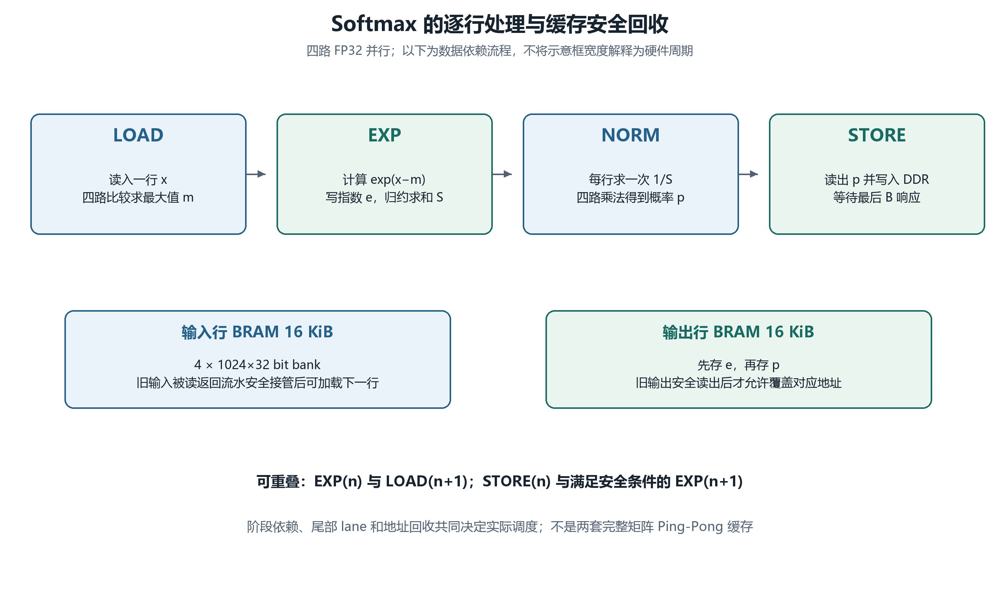

图14 Softmax 的行处理过程和缓存复用条件。读返回流水接管旧数据后才允许写入新数据。[可编辑 Draw.io 源文件](figures/15_softmax_row_pipeline.drawio)

软件提交一张 FP32 矩阵后，加载阶段逐行更新最大值，指数阶段读出原输入并对齐求和，行末完成倒数计算，归一化阶段写回概率，最后通过 AXI 送回 DDR。下一行不必等上一行所有阶段完全结束才准备，但每个缓存地址的覆盖必须满足安全回收条件。对尾部不足四个元素的 beat，只有有效 lane 参与计算，写回的无效 lane 为 +0。

**缓存端口与扫描周期。** 每行输出缓存经历 W 次写 e、W 次读 e、W 次写 p 和 W 次读 p，共 2W 次读和 2W 次写。因为每块缓存为一读一写端口，理想稳态至少需要 2W 拍完成一行的输出缓存操作。通过 LOAD 与 EXP、前一行 STORE 与下一行 EXP 重叠，忽略算术尾部和总线等待时，M 行的主体扫描可估算为 `(2M+2)W` 拍；首行加载与末行写出构成额外的 2W。

对于 1024×1024，W=256，主体估算为 524800 拍，250 MHz 下为 2.0992 ms。实际还需计入最大值排空、27 级指数流水、行和归约与转换、倒数、8 级归一化及安全回收和 AXI 等待。实际总周期还包括这些流水尾部、缓存安全回收与 AXI 等待，应由当前测试运行的计数器统计。

**（9）关键输入输出及系统握手**

AXI-Lite 用于地址、尺寸、启动、状态及统计寄存器访问；AXI4 用于矩阵读写。DMA 处理 burst、4 KiB 边界和响应错误，控制器在错误时停止新任务并排空已接受事务。[4]

表4 关键输入输出与控制信号

| 类别 | 主要信号或参数 | 设计作用 |
|---|---|---|
| 公共时钟复位 | `aclk`、`aresetn` | 驱动算子与 AXI 接口时序 |
| AXI-Lite 写通道 | AW、W、B 及各自 VALID/READY | 配置、启动及写响应 |
| AXI-Lite 读通道 | AR、R 及各自 VALID/READY | 读取状态和统计 |
| AXI4 读通道 | ARADDR、ARLEN、RDATA、RLAST、RRESP | 输入 burst 读取与响应检查 |
| AXI4 写通道 | AWADDR、AWLEN、WDATA、WSTRB、WLAST、BRESP | 输出 burst 写入及完成确认 |
| GEMM 配置 | A/BT/C 物理地址、M/N/K | 确定矩阵布局和运算范围 |
| Softmax 配置 | 输入/输出物理地址、M/K | 确定行数、行长及补齐布局 |

AXI 各通道保持独立握手，VALID 遇到背压时保持数据和地址稳定。最后一个 W beat 被接受不等于任务完成；驱动必须等待完整完成状态及最后写响应，才能允许 CPU 读取结果或释放内存。

## 2.3 软件系统介绍

### 2.3.1 软件整体介绍

软件以 PYNQ 为硬件访问基础，以 Python 单文件驱动封装寄存器控制和任务状态。当前三核部署包包含 `accelerator_driver.py`、配套 bit/HWH 和使用说明。应用程序通过 PYNQ Overlay 加载 bitstream，再通过 `AcceleratorDriver.from_hwh()` 解析控制地址和 DDR 映射。当前驱动本身不加载 bitstream、不申请或映射 CMA、不复制或转置矩阵；这些工作由调用方完成。[7][10]

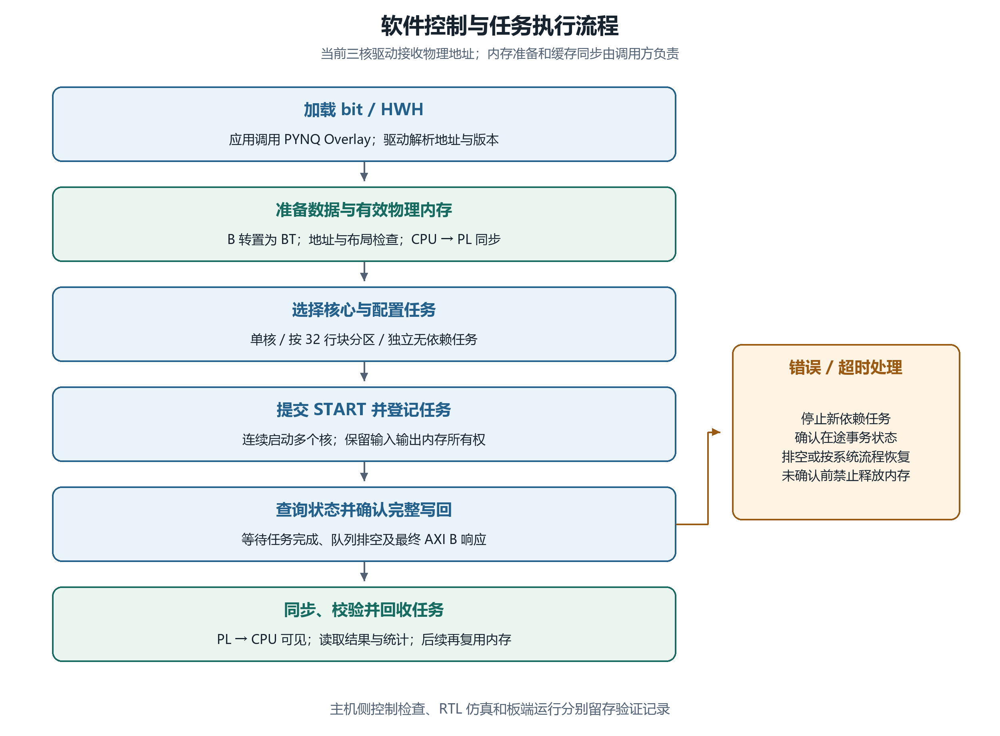

图15 一次算子任务的软件执行流程。运行过程中须保持 DDR 缓冲区有效，异常路径先处理在途事务，再决定是否重用内存。[可编辑 Draw.io 源文件](figures/06_software_flow.drawio)

板端软件分为应用控制、任务调度、设备访问和数据准备四个职责。应用控制决定模型或测试流程；调度模块选择参与核心和行分区；设备访问通过 MMIO 配置与轮询寄存器；数据准备完成连续布局、必要的转置、物理内存管理和缓存同步。

仓库中的旧双核自动 CMA 驱动与当前三核物理地址驱动使用方式不同。本报告的软件实现以三核部署包为准，CPU/单核/多核对照 Notebook 的测量方法可复用，但不能直接使用旧 bit/HWH 的设备数量、地址或分配假设。

### 2.3.2 软件各模块介绍

**（1）硬件加载与设备发现**

应用先加载同名配套 bit/HWH。驱动从 HWH 获取三个 GEMM 和一个 Softmax 的控制窗口、数据地址范围及相关参数，并检查 GEMM ABI 签名。元数据检查用于发现地址或版本不匹配，不等同于实际执行矩阵计算成功。

**（2）输入输出与内存管理**

GEMM 的输入为连续 INT8 A 和连续 INT8 BT，输出为连续小端 INT32 C。A/BT/C 基地址满足 32 字节对齐。调用方负责在需要时转置 B，并在 START 前将 CPU 修改同步至 PL 可见的内存。结果完成后，按系统一致性要求使 PL 写入对 CPU 可见。

Softmax 输入输出为小端 FP32，基地址 16 字节对齐。行跨度为 `16×ceil(K/4)` 字节；K 不是 4 的倍数时，尾部补齐，有效 lane 之外的输入被忽略、输出写入 +0。不能将未补齐的紧密矩阵直接作为该布局提交。

例如 M=3、K=5 时，每行需要两拍、32 字节，输入和输出各申请 `3×32=96` 字节。第 i 行第 j 个有效元素位于 `BASE+i×32+j×4`，有效 j=0…4；第二拍仅 lane0 有效，其余三路输出为 +0。尺寸寄存器按 `DIM_MK=((K−1)<<16)|(M−1)` 编码，本例写入 `0x00040002`。这与 GEMM 以 32 为单位编码维度的规则不同。

**（3）单核与三核 GEMM 并行驱动**

驱动的任务调度层负责将一个矩阵乘法分配给三个独立硬件核，是三核同时计算的软件实现部分。`submit_gemm_rows()` 默认使用 `cores=(0, 1, 2)`，按 32 行块划分 M 维；指定 `cores=(2,)` 可只使用 GEMM 2，也可选择两个核。M 不足以为每个核分配 32 行时，自动减少参与核数。该划分保持完整 K 维计算，不需要 CPU 对多个部分和做归约。

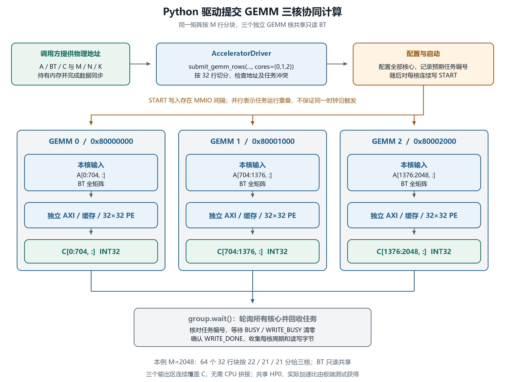

图16 Python 驱动的三核 GEMM 调度。三个核共享 DDR 中只读 BT，分别处理不同的 A 行和 C 行，配置后连续启动，并由任务组统一等待。[可编辑 Draw.io 源文件](figures/07_three_core_driver.drawio)

设某核分到的起始行为 r、行数为 mᵢ，则其输入为 `A[r:r+mᵢ, :]` 和完整 BT，输出为 `C[r:r+mᵢ, :]`。由于 A/BT 为 INT8、C 为 INT32，三个基地址分别为：

```text
A_i  = A_base + r × K         # 每个 A 元素占 1 字节
BT_i = BT_base               # 三个核共享只读权重的 DDR 地址
C_i  = C_base + r × N × 4     # 每个 C 元素占 4 字节
```

以 `A[2048,2048] × B[2048,512]` 为例，M 维有 64 个 32 行块，驱动按 22、21、21 个块分给三核，如表5。分区的 C 地址直接覆盖完整输出矩阵，完成后无需 CPU 复制拼接。BT 仅在 DDR 地址层面共享，各核仍通过自己的 DMA 装入本地缓存；这不会消除多核对同一权重的重复 DDR 读取。

表5 三核共同计算一个矩阵的分工示例，行区间采用左闭右开记法

| 核心 | 32 行块数 | A/C 行区间 | 本核 M、N、K |
|---|---:|---|---|
| GEMM 0 | 22 | `[0,704)` | 704、512、2048 |
| GEMM 1 | 21 | `[704,1376)` | 672、512、2048 |
| GEMM 2 | 21 | `[1376,2048)` | 672、512、2048 |

**分区与地址偏移的具体计算。** 令 `B=M/32`、参与核数为 p，先计算 `q=floor(B/p)`、`e=B mod p`；按核心列表顺序，前 e 个核分配 q+1 个块，其余分配 q 个块。第 i 个核的行数 `m_i=32×(q+[i<e])`，起始行是之前各核行数之和。各核相差最多 32 行，且每核保留完整的 K 和 N。

本例 B=64、p=3，所以 q=21、e=1。GEMM 1 的 A 偏移为 `704×2048=1441792` 字节，GEMM 2 的 A 偏移为 `1376×2048=2818048` 字节；因为 `N×4=2048`，两个 C 偏移恰好与 A 偏移相同。首核 `DIM_MN=0x00100016`，后两核为 `0x00100015`，三核 `DIM_K` 均为 `0x40`。这些相同的字节偏移是本例 K=N×4 的结果，其他形状仍须分别计算。

各分区的有效 MAC 数为 `m_i×N×K`，依次为 738197504、704643072、704643072，合计 2147483648。仅按等速、无传输限制的计算负载估算，最长分区为 704 行，负载划分允许的理想加速比为 `2048/704≈2.91`。该估算只反映分区不均，实际速度还受宏块数量、共享总线和软件启动影响。

**三核的输入流量推导。** 按本文 GEMM_V2 的冷缓存路径算法，各核的宏条带上限均为 256 行，N 方向有两组，M 方向有三组。规划器选择列蛇形并从尾行开始，使转弯保留一个完整的 256 行 A 条带，读取行数为 `L_col=512+2m_i−256`。由此得到下表；这些是算法推导值，部署 bitstream 的实际流量仍由每核计数器核验。

| 分区 | 计算用行数 m_i | 输入读取行数 | 输入读取字节 | C 写入量 |
|---|---:|---:|---:|---:|
| GEMM 0 | 704 | 1664 | 3.25 MiB | 1.375 MiB |
| GEMM 1 | 672 | 1600 | 3.125 MiB | 1.3125 MiB |
| GEMM 2 | 672 | 1600 | 3.125 MiB | 1.3125 MiB |
| 三核合计 | 2048 | 4864 | 9.5 MiB | 4 MiB |

同一任务单核读取 8.5 MiB，三核分区推导为 9.5 MiB，输入流量增加约 11.76%；计入相同的 4 MiB 输出后，总流量从 12.5 MiB 增至 13.5 MiB，增加 8%。因此，多核带来的计算并行收益需要与额外流量共同评价；DDR 中共享一个 BT 地址不会使三个片上缓存自动共享内容。

一次三核任务的控制过程如下。

1. **发现与检查。** 驱动连接 `0x80000000`、`0x80001000`、`0x80002000` 三个控制窗口，读取各核 `CAP_CONFIG` 并检查 ABI；检查维度、32 字节对齐、DDR 映射和矩阵地址范围。提交前确认参与核空闲，允许只读输入共享，拒绝 C 覆盖输入、多个输出重叠及未完成任务的读写冲突。
2. **先配置全部核心。** 分别写入 `0x201` 清除旧状态，保存上一任务编号，再写 A/BT/C 地址、`DIM_MN` 和 `DIM_K`。在任何新 START 发出前完成所有参与核的配置，减少运行中的软件干预。
3. **连续启动。** 为每核登记任务句柄后，依次向三个 CTRL 写入 `0x101`。Python/MMIO 写入存在时间间隔，“三核同时计算”表示三个任务的运行区间重叠，不保证它们在同一个硬件时钟沿启动。
4. **轮询并确认写回。** 任务组轮询全部核，核对各自递增后的 `ACCEPTED_JOB`；对每核等待 BUSY、WRITE_BUSY 清零，并确认 WRITE_DONE 和匹配的 `WRITE_DONE_JOB`。发现 ERROR 时先等待事务排空，再报告异常；超时保留任务和缓冲区，后续可继续等待。
5. **收集统计与交付结果。** 读取每核总周期、计算/加载/writer 活跃周期和读写字节，回收任务句柄。全部核完成后由调用方同步输出缓存、校验 C 并使用结果，最后按内存管理策略复用或释放缓冲区。

关键调用代码如下，`A_ADDR`、`BT_ADDR`、`C_ADDR` 必须是调用方实际持有、已完成布局和缓存同步的 DDR 物理地址；驱动返回统计和任务信息，结果数据仍在 C 对应内存中。

```python
# acc 已连接当前三核 bit/HWH；A、BT、C 内存在任务期间持续有效。
group = acc.submit_gemm_rows(
    a_addr=A_ADDR, bt_addr=BT_ADDR, c_addr=C_ADDR,
    m=2048, n=512, k=2048,
    cores=(0, 1, 2),             # 默认三核，也可改为 (0,) 做单核对照
)
results = group.wait(timeout_s=10.0)  # 统一等待三核，包括最终 AXI 写响应
for result in results:
    print(result["device"], result["row_start"],
          result["shape"], result["counters"])
# 调用方随后执行需要的 PL→CPU 缓存同步，再读取和校验 C。
```

对于互不依赖的三个矩阵任务，`submit_gemm_batch()` 可为每个核配置不同的 A/BT/C 和尺寸；单核任务使用 `submit_gemm()`。任务组的轮询由一个软件调度流程完成，硬件核在 PS 不持续送指令时仍可独立运行，不要求创建三个 Python 计算线程。

三核加速比受最长分区、启动偏斜、缓存复用和共享 HP0 带宽共同限制。BT 的重复加载和其他主设备竞争也可能增加等待。报告的多核性能应使用同一输入下的单核/三核实测，并把转置、复制、缓存同步、三核配置与等待都纳入端到端时间，不能直接将单核周期除以三作为三核结果。[10]

**（4）算子调用接口与关键变量**

表6 主要接口与输入输出

| 接口 | 关键输入 | 返回与作用 |
|---|---|---|
| `AcceleratorDriver.from_hwh()` | 配套 HWH 路径 | 设备控制对象、地址映射检查 |
| `submit_gemm()` | 核编号、A/BT/C 地址、M/N/K | 单核任务句柄 |
| `submit_gemm_rows()` | A/BT/C 地址、M/N/K、核心集合 | 分区任务组，输出仍位于 C |
| `submit_gemm_batch()` | 指定不同核心的 GEMM 任务列表 | 独立任务组，先统一配置再连续启动 |
| `run_gemm_rows()` | 同上，另含超时参数 | 阻塞等待并返回任务元数据 |
| `submit_softmax()` | 输入/输出地址、M/K | Softmax 任务句柄 |
| `task.poll()` / `task.wait()` | 任务句柄、超时 | 完成结果或异常 |
| `close()` | 控制对象状态 | 关闭控制对象；不释放调用方矩阵内存 |

提交接口执行“参数及地址检查→关联冲突检查→寄存器配置→任务句柄登记→START”。在 START 前保留句柄，可以在 MMIO 写入异常但硬件可能已收到命令时继续跟踪任务。等待接口执行“状态读取→任务完成或错误判断→写回确认→统计收集→任务回收”。结果记录包含任务元数据，矩阵数据仍位于调用方传入的 DDR 区域。GEMM 可读取硬件周期和传输字节；Softmax 当前不提供硬件周期寄存器，软件观察耗时与测试台周期需分别记录。

**（5）Attention 与模型接入接口**

标准 Attention 可表示为 `Softmax(QKᵀ/√d + mask)V`。目前两个已实现算子的输入输出类型不同，GEMM 的 INT32 输出不能直接按位当作 Softmax 的 FP32 输入。串联时必须执行正确的缩放、类型转换及 mask；Softmax 输出送入 INT8 GEMM 前，还需完成量化及布局转换。[2][6]

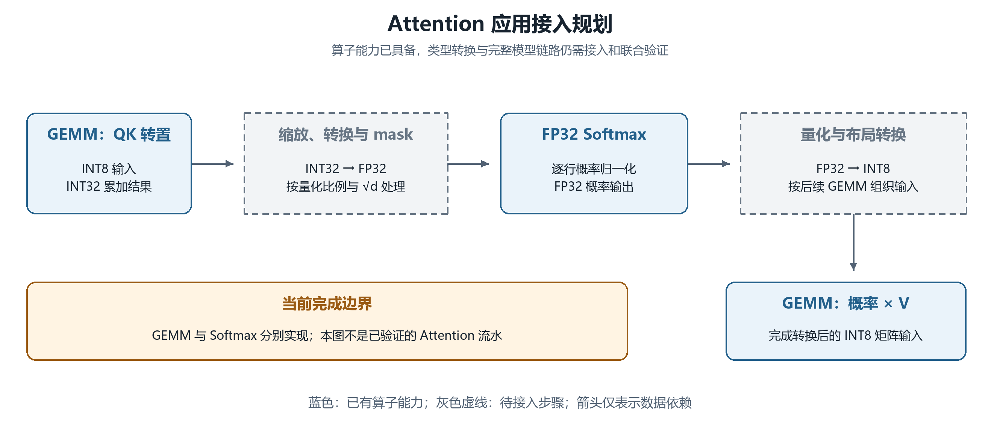

图17 Attention 接入规划。蓝色节点为已具备的算子能力，灰色节点为需要接入并验证的转换及模型处理步骤；整条链路尚未完成联合验证。[可编辑 Draw.io 源文件](figures/07_attention_integration.drawio)

本阶段不将量化、反量化、LayerNorm 或完整模型解析列为已完成模块。后续可先由 PS 实现这些连接步骤，建立可校验的模型基线，再评估是否迁移至 PL。存在生产者—消费者依赖时，必须等待前一任务完整完成并处理数据可见性，再提交后一任务。

**Attention 各步骤的计算与形状。** 以一个注意力头为例，设查询 Q 为 `L_q×d`，键 K 为 `L_k×d`，值 V 为 `L_k×d_v`。这里 K 表示键矩阵；向 GEMM 接口提交时的 K 参数仍表示归约维长度。计算先生成 `S=QKᵀ/√d+mask`，S 的形状为 `L_q×L_k`，再逐行计算 `P=Softmax(S)`，最后生成 `O=PV`，形状为 `L_q×d_v`。

第一次 GEMM 配置为 `(M,N,K)=(L_q,L_k,d)`，BT 的存储内容就是连续行布局的键矩阵；第二次配置为 `(L_q,d_v,L_k)`，BT 的内容为预先转置的 V，即 `Vᵀ[d_v,L_k]`。前一步每个查询和每个键做 d 项点积，后一步每个输出通道沿 L_k 个注意力权重求加权和。多头需要分别保留各头的尺度、行范围和输出布局，之后才能拼接并执行输出投影。

以对称 INT8 量化的接入方案为例，若真实数据近似为 `Q≈s_Q×q_Q`、`K≈s_K×q_K`，第一次 GEMM 输出为整数 `C_QK=q_Q×q_Kᵀ`。送 Softmax 前须计算 FP32 分数 `S≈(s_Q×s_K/√d)×C_QK+mask`。若使用逐通道尺度，这个乘数也须按对应通道广播。若采用带非零零点的仿射量化，还需展开 `(q_Q−z_Q)(q_K−z_K)` 的交叉项和常数项，当前原始 INT8 点积接口不会自动完成零点校正。

例如只用于说明尺度换算，取 `d=2`、`Q=[0.8,0.4]`、一个键向量 `K_0=[0.3,0.7]`，并设 `s_Q=s_K=0.1`。量化后 `q_Q=[8,4]`、`q_K0=[3,7]`，INT8 点积为 `8×3+4×7=52`；还原并缩放后的分数为 `0.1×0.1×52/√2≈0.367696`。若第二个键的分数为 0，Softmax 两项约为 `[0.590902,0.409098]`。再取 `s_P=1/127`、`s_V=0.01`、`V=[0.20,0.70]`，RNE 量化得到 `q_P=[75,52]`、`q_V=[20,70]`，第二次 GEMM 的整数结果为 `75×20+52×70=5140`，反量化输出约为 `5140×(1/127)×0.01=0.404724`。以未量化概率直接加权得到约 0.404549，量化造成的差值约为 `1.75×10⁻⁴`；这些数值仅为算式示例，不代表具体模型的校准尺度或精度结果。

Softmax 产生 FP32 概率 P 后，可按模型校准尺度 s_P 计算 `q_P=clip(RNE(P/s_P),−128,127)`；V 同样按尺度 s_V 转换为 q_V。第二次 GEMM 计算 `C_PV=q_P×q_V`，随后恢复 `O≈s_P×s_V×C_PV`。概率过小可能量化成零，概率过大可能饱和，因此必须比较最终 Attention 输出和模型任务精度，不能仅凭算子整数结果正确就认定模型无损。

维度不满 32 时，GEMM 输入需补零到 32 的倍数；有效维度 d 的补零不改变点积，但 Attention 的缩放仍使用原来的 d。补入的键位置在 Softmax 前加 −inf mask，额外查询行的结果在返回模型前去掉。当前 Softmax 行长不超过 4096；超过该长度的单行不能直接分段后各自归一化再拼接，否则改变共同分母。

线性投影可表示为 `Y=XW+b`，其中 X 为 T×D、W 为 D×H；GEMM 提交 `(T,H,D)`，整数结果完成尺度恢复后再加偏置 b。前馈层按模型结构组合线性变换和激活，例如 `FFN(X)=φ(XW_1+b_1)W_2+b_2`；LayerNorm 则需逐行计算均值 `μ=Σx/D`、方差 `σ²=Σ(x−μ)²/D` 和 `y=γ(x−μ)/√(σ²+ε)+β`。这些是后续算子覆盖和 PS 连接计算的定义，具体激活、门控和归一化形式须以所选 SmolVLA 模型配置为准。

**（6）异常与生命周期管理**

软件对超时、配置错误、算子错误及地址冲突分别处理。超时不代表硬件已经停止访问 DDR；在确认事务排空前，不能释放或覆盖相关缓冲区。驱动返回错误后，由调用方完成恢复流程。bitstream 重载和系统复位也需要与在途事务管理协调，避免仅复位 master 而内存端仍保留旧事务。

# 第三部分  完成情况及性能参数

## 3.1 整体介绍

目前已形成 GEMM_V2 与 Softmax 的 RTL、测试脚本、系统实现报告及 Python 控制接口，并保存包含三个 GEMM_V2 核和一个 Softmax 的 bitstream/HWH。该成果证明核心算子及系统硬件工程已建立，尚不能替代板端计算、完整模型推理或机械臂闭环的验证。[8][9][10]

当前阶段的可确认成果及后续工作见表7。单算子 RTL 回归、系统实现报告和板端测试分别记录，避免将不同测试阶段的数据合并为同一个端到端结果。

表7 完成情况

| 项目 | 当前完成情况 | 证据或后续工作 |
|---|---|---|
| GEMM RTL | 已完成单 AXI GEMM_V2 及配套回归环境 | RTL、testbench 和回归脚本已整理；重新运行结果由对应版本的测试输出确认 |
| Softmax RTL | 已完成四路 FP32 设计 | 当前源码默认端到端回归 21 个用例通过；完整矩阵及板端测试另行执行 |
| 多核硬件工程 | 已集成 3 个 GEMM＋1 个 Softmax | 15eg 工程、整机实现报告、配套 bit/HWH |
| Python 控制 | 已实现单文件三核物理地址驱动、按行协同和独立任务 | 主机侧驱动协议测试与板端测试分开记录 |
| PYNQ 板端测试 | 待补齐 | 测试脚本、环境和结果按 `tests/pynq/README.md` 组织 |
| 完整 Attention / SmolVLA | 待接入 | 补齐类型转换、算子覆盖及模型调度 |
| SO-101 应用闭环 | 待联调 | 摄像头、状态读取、动作下发与任务成功率测试 |

> 待补实物或工程截图：整个系统正面实物照片，包含 ZU15EG 板卡、摄像头、机械臂及工作台。
>
> 待补实物或工程截图：整个系统斜 45° 实物照片，清楚展示板卡、供电与通信连接。

## 3.2 工程成果

### 3.2.1 机械成果

机械部分以现成 SO-101 的安装、摄像头定位及测试工作空间构建为目标，应用端尚处于接入准备阶段。后续将完成整机安装、通信连接与动作实验，分别记录现成机构和自主制作安装部件的来源、尺寸及作用。

> 待补实物或工程截图：机械臂与摄像头实际安装照片；图中标注末端执行器、目标物体区域和摄像头位置。

### 3.2.2 电路成果

当前工程已完成三个 GEMM 核、一个 Softmax、PS 和 AXI 互连的集成，并生成器件为 `xczu15eg-ffvb1156-2-i` 的 bitstream。部署包保存对应 HWH、文件来源及 SHA256。HWH 中 GEMM 核均为单 AXI 主接口，四个数据主接口经 SmartConnect 连接 HP0，控制地址与表1一致。[10]

当前整机布局布线报告显示，375095 条可布线网络全部完成，布线错误为 0；4 ns 时钟下 setup 与 hold 均满足报告中的约束。该实现报告生成于 2026 年 11 月 3 日，部署包中的 bitstream 于 2026 年 11 月 2 日导出。报告证明对应实现结果满足所设时序约束，不代表已经完成板上长时间稳定性、供电功耗或机器人运行测试。

> 待补实物或工程截图：ZU15EG 板卡正面及接口接线照片。
>
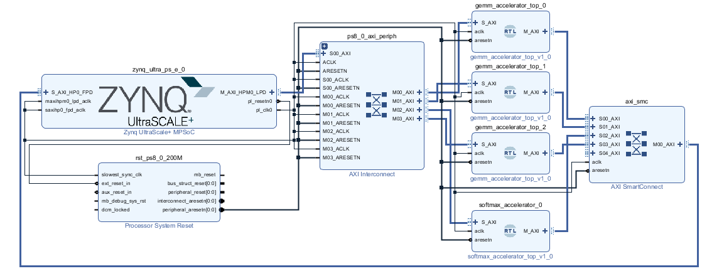

图18 原稿中的 Vivado Block Design 实截图，展示 PS、三个 GEMM、一个 Softmax 及控制与数据互连。连接关系结合 HWH 和图3 共同阅读。[Draw.io 素材页](figures/17_vivado_block_design.drawio)
>
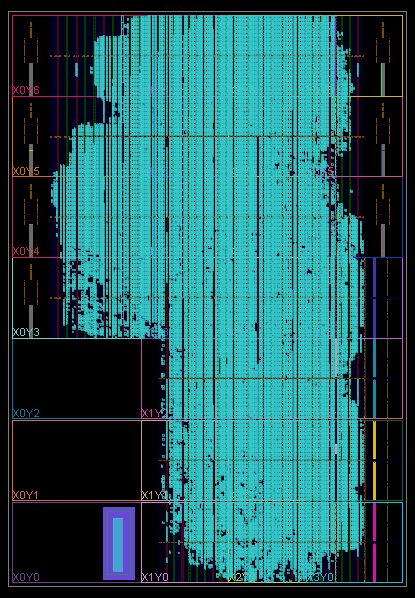

图19 原稿中的 Vivado 物理布局实截图，保留器件资源列与已放置逻辑的空间分布。截图未按核着色，不能仅据颜色判定某个 GEMM 或某类缓存的精确位置。[Draw.io 素材页](figures/20_vivado_floorplan.drawio)

输入缓存的 BRAM/URAM 逻辑分区先由 RTL bank 组织及存储属性指定，Vivado 再在器件对应资源列上完成实际放置。布线优化需要同时检查存储至阵列、全阵列控制扇出和 Writer 地址路径，结合关键路径报告决定是否增加寄存或调整局部布局。当前资源分布截图用于展示实现规模，时序是否收敛仍以布线后的具名报告为准。

### 3.2.3 软件成果

软件成果包含单文件驱动、配套部署目录、调用说明及矩阵性能测试 Notebook。三核驱动可以组织按行分工、独立任务和无数据依赖的 GEMM/Softmax 并发，提供任务等待、状态查询及错误处理接口。主机侧单元测试验证软件控制逻辑，不等同于板端 AXI 数据传输成功。[10]

三核协同部分已实现 M 维 32 行对齐分区、A/C 子地址计算、只读 BT 共享、全核配置后连续 START、任务组轮询和每核统计收集。单核选择和三核独立矩阵任务使用同一驱动，任务提交前进行地址冲突检查；超时后允许继续等待，部分启动失败时保留可能已经运行的任务句柄。该实现与 2.3.2 节的算法及接口对应，板端三核正确性、共享带宽和端到端加速比在 3.3.5 节通过实测补充。

性能测试界面需要同时显示设备版本、时钟、矩阵尺寸、参与核数、正确性校验及分项耗时。CPU 基线需说明实现、数据类型与线程设置；NumPy INT32 整数基线可以作为软件对照，但不能代表经过 NEON 或专用库优化后的 CPU 峰值。

> 待补实物或工程截图：实际 PYNQ/Notebook 界面，包含硬件识别、任务启动、结果校验及原始计时记录。
>
> 待补实物或工程截图：CPU、FPGA 单核与三核的板端对比图；在获得实测前不填写加速比。

## 3.3 特性成果

### 3.3.1 测试条件与统计方法

测试按功能、性能和实现三个层次组织。功能验证比较全部输出并覆盖边界和错误情况；性能验证固定输入、DDR 服务和计时边界；实现验证记录器件、工具、时钟约束、资源及布线状态。

表8 验证内容及适用范围

| 记录 | 对象与条件 | 可以支持的结论 |
|---|---|---|
| GEMM_V2 RTL 回归 | 32×32 阵列、AXI 接口、缓存与调度的 testbench | 检查数值、协议、边界和错误恢复；通过结果应关联本次运行输出 |
| Softmax RTL 回归 | 四路 FP32 数据通路及 AXI 端到端 testbench | 当前默认回归覆盖 21 个用例；不代表完整模型或板端测试 |
| 整机实现报告 | ZU15EG；3 个 GEMM_V2 核＋1 个 Softmax；4 ns 时钟约束 | 报告中的放置资源、布线状态和时序结果 |
| PYNQ 板端端到端测试 | 待补充脚本和结果 | 记录 CPU/PL 数据准备、真实 DDR、多核收益及应用延迟 |

GEMM 的 `job_cycles` 统计任务接受至最终完成，包括写响应排空；测试台总周期还包含寄存器配置、轮询与任务编号读取。加载、计算和 writer 活跃周期可相互重叠，不能相加为总周期；writer 活跃还包含排队和等待，不能当作 AXI W 有效传输拍数。

板端应另行记录一次性初始化时间及每任务端到端时间。每任务时间包含输入复制、B 转置、缓存同步、寄存器配置、运算、完整写回和结果取得；若权重已常驻或预先转置，则作为另一测试场景单独列出。Softmax 测试台周期与其驱动的软件观察时间也应分别展示。

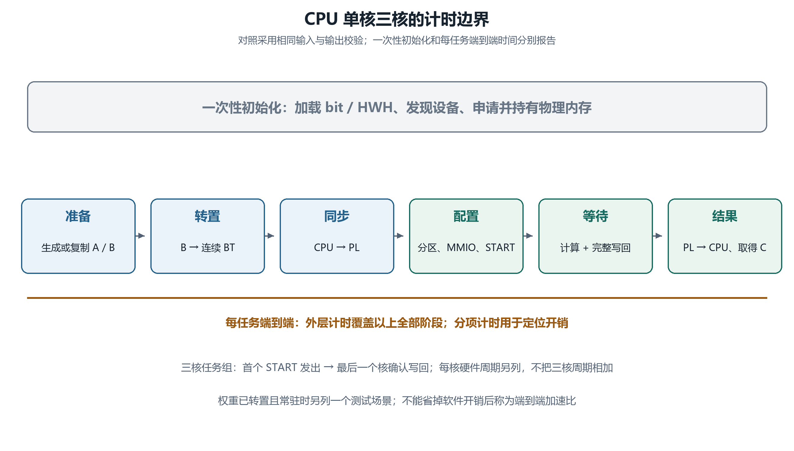

图20 CPU、单核和三核测试的初始化及每任务计时范围。只有同一计时边界的结果才可用于加速比对照。[可编辑 Draw.io 源文件](figures/16_benchmark_scope.drawio)

先在小规模矩阵上逐元素校验，再扩大 M/N/K 并固定随机种子、精度和线程数。每个场景先预热，重复运行后报告中位数与波动范围；CPU 结果应使用不会发生 INT8 溢出的 INT32 参考。纯硬件时间可由任务周期除以核时钟得到，PS 观察到的执行时间还包括 MMIO 和轮询延迟，外层端到端时间则继续覆盖数据准备、转置和缓存同步。这三种时间分别命名，避免混用。

### 3.3.2 GEMM 性能指标的计算方法

GEMM 硬件输出为 M×N 个 INT32。有效乘加数为 MNK；若乘法和加法分别按一次操作计数，总运算量为 2MNK。32×32 阵列含 1024 个 PE，单核每拍最多执行 1024 次 MAC；目标频率为 f 时，理论峰值为 1024×f×2 次操作/秒。该数值是结构上限，不是板端实测吞吐。

若硬件任务计数器记录 C 个周期，任务内核时间为 C/f；有效吞吐按 2MNK/(C/f) 计算。完整端到端计时还应分别记录数据准备、BT 转置、缓存同步、寄存器提交、硬件等待和结果校验。输出字节数为 4MN；AXI 实际读流量应按读通道有效握手统计，不能只用输入矩阵尺寸推算，因为缓存复用会改变重复读取量。算术强度按 2MNK/(实际读取字节数+实际写入字节数) 计算。

板端对比应固定输入、正确性参考、DDR 缓存策略、计时范围和预热/重复次数，分别报告单核、多核和 CPU 的时延分布。当前 PYNQ 测试脚本和实测数据待补充。

### 3.3.3 Softmax 功能与精度

当前 Softmax 源码的默认端到端回归包含 21 个用例，覆盖尾 lane、mask、非正规数、特殊输入、AXI 错误恢复和随机背压；完整板端验证仍待补充。[9]

对 M×K 的 FP32 矩阵，每个 128-bit beat 携带 4 个元素，令 W=ceil(K/4)，每行传输 W 个 beat。不计额外突发对齐填充时，读、写各为 16MW 字节，总流量为 32MW 字节。若硬件计数器记录 C 个周期、时钟为 f，元素吞吐为 MK/(C/f) 个/秒；读写平均带宽按实际 AXI 传输字节数除以相同计时区间计算。

将硬件结果 p 与相同有效 lane 和 mask 下的软件参考 p_ref 对比，最大绝对误差为 max|p−p_ref|，最大行和误差为 max_row|Σp−1|。相对误差可使用 |p−p_ref|/max(|p_ref|,ε_ref)，并记录 ε_ref；接近零的概率同时报告绝对误差。参考程序还应明确 DAZ、FTZ 语义。板端记录还应包括矩阵形状、数据准备与 DMA 同步时间，不能用 RTL 测试台周期替代主机观察到的端到端时间。

两块行缓存合计容量为 2×4×1024×32/8=32768 字节，即 32 KiB；两份指数 ROM 为 16 KiB，RX/TX 各 32×128 位队列合计 1 KiB，已列数据容量约 49 KiB。浅层返回队列、流水寄存器、有效标志和地址 tag 另计，因此不能将 49 KiB 当作综合报告中的全部物理存储占用。


### 3.3.4 资源利用与时序实现

整机资源取自 15eg 工程的放置后资源报告，时序取自相同实现目录的布线后报告。资源表不是单核资源简单相加，也不与独立 OOC 报告混用。[10]

表11 三核 GEMM＋Softmax 整机资源

| 资源 | 已使用 | 器件可用 | 利用率 |
|---|---:|---:|---:|
| LUT | 197334 | 341280 | 57.82% |
| 寄存器 | 256241 | 682560 | 37.54% |
| Block RAM Tile | 360 | 744 | 48.39% |
| URAM | 72 | 112 | 64.29% |
| DSP | 3093 | 3528 | 87.67% |

其中 BRAM 原语为 348 个 RAMB36 和 24 个 RAMB18，折合 360 个 Block RAM Tile；不能把两类原语个数直接当作相同容量相加。DSP 占比接近九成，后续扩展更适合优先评估现有计算核复用、流水调度与带宽效率。

表11 的利用率统一按 `已使用/器件可用×100%` 计算：LUT 为 `197334/341280≈57.82%`，寄存器为 `256241/682560≈37.54%`，DSP 为 `3093/3528≈87.67%`，URAM 为 `72/112≈64.29%`。BRAM Tile 折算为 `348+24/2=360`，再以器件可用的 744 Tile 为分母，得到 `360/744≈48.39%`。原稿资源截图中的 LUT/FF 数量与当前放置后报告一致。逻辑有效字节容量、RAM 原语物理容量和综合后的资源个数是不同口径，存储位宽拼接、深度和校验位均会影响物理映射，不能用缓存字节数直接替代资源报告。

32×32 阵列每 PE 使用一个 DSP 乘法器，三个阵列对应 `3×1024=3072` 个 DSP；按对应实现中的运算单元结构核对 Softmax 的 DSP 使用量；具体资源归属以同一版本的综合层级报告为准。两项相加为 3093，与整机报告数量相符。这是依据已知模块结构作的数量核对，最终层级归属仍以同版综合报告为准。

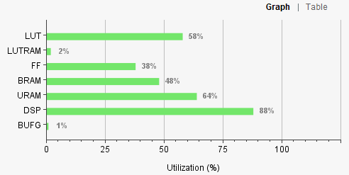

图22 原稿所附 Vivado 资源利用柱状图，用于直观展示 DSP、URAM、BRAM 与逻辑资源的占用情况。[Draw.io 素材页](figures/18_vivado_utilization_chart.drawio)

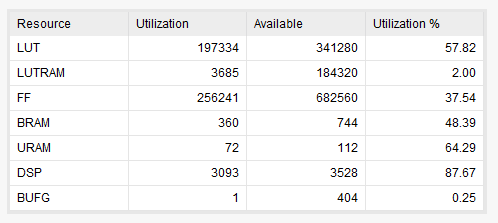

图23 与上图对应的原稿资源数值截图。截图中的 LUT 为 197334、FF 为 256241，与表11 当前具名实现报告一致；表中保留放置后报告的数值用于占比计算。[Draw.io 素材页](figures/19_vivado_utilization_table.drawio)

表12 整机布线后时序与状态

| 项目 | 结果 |
|---|---|
| 时钟 | `clk_pl_0`，4.000 ns，250 MHz |
| WNS / TNS | +0.016 ns / 0 ns |
| WHS / THS | +0.010 ns / 0 ns |
| setup / hold 失败端点 | 0 / 0 |
| 已完全布线 / 可布线网络 | 375095 / 375095 |
| 布线错误 | 0 |

该整机实现结果晚于独立单核 OOC 记录，作为本报告的整机实现证据。布线后 WNS 的计算含义为最差 setup 路径的 slack；+0.016 ns 表示最差路径仍有 16 ps 正裕量。WHS 为 +0.010 ns，最差 hold 路径有 10 ps 正裕量，TNS/THS 均为 0 且失败端点为 0。它表示报告内用户约束得到满足，不替代板端时钟核验、温度与供电条件下的运行验证。本报告仅记录对应整机实现报告中的结果，不将独立 OOC 数据混入整机 WNS。

### 3.3.5 板端测试与应用验证

最终板端测试按“算子正确性→单核基线→多核收益→算子串联→应用任务”逐步进行。固定输入和软件环境，预热后重复计时并保存原始记录，分别报告中位数、波动范围和测试次数。数据准备与权重常驻场景分别统计，避免用一次性加载开销或不同输入精度改变对照口径。

表13 待补充的板端与应用指标

| 测试 | 需记录的量化指标 | 当前状态 |
|---|---|---|
| GEMM CPU / 单核 / 三核 | 相同输入的全部输出校验、整体时间、分项时间、加速比 | 待板端记录 |
| 三核任务与启动 | 各核 ACCEPTED_JOB/WRITE_DONE_JOB、START 软件时间戳与启动偏斜 | 待板端记录；硬件同拍精度需另加观测手段 |
| 三核负载均衡 | 每核行区间、任务总周期、计算/加载/writer 活跃周期 | 待板端记录 |
| Softmax | 最大绝对/相对误差、行和误差、整体耗时 | 待最终版本板端记录 |
| 三核带宽 | 各核与合计读写字节、任务组时间、HP0 有效带宽 | 待板端记录 |
| 并发竞争 | 三核 GEMM 单独执行与叠加独立 Softmax 时的耗时、流量变化 | 待板端记录 |
| Attention 串联 | 转换耗时、输出误差、依赖调度 | 待集成 |
| SmolVLA | 模型版本、输入尺寸、动作生成延迟与精度变化 | 待部署验证 |
| SO-101 闭环 | 任务定义、重复次数、成功率、动作周期 | 待应用联调 |
| 功耗与能效 | 明确测量边界的空闲/工作功率、每任务能耗 | 待仪器测试 |

单核与三核测试使用相同的 M/N/K、输入矩阵、数据类型与软件参考，完整校验 C，重点检查 704 行和 1376 行附近的分区边界。单核指定 `cores=(0,)`，三核指定 `cores=(0,1,2)`。分别报告数据复制、B 转置、缓存同步、寄存器配置与启动、任务等待以及结果取得的时间；bitstream 加载和首次内存申请作为一次性初始化单列。每任务端到端时间使用外层连续计时得到，各分项用于定位开销。

任务组执行时间按首个 START 发出至最后一个核确认写回计时，每核硬件周期单独记录，不能把三核周期相加作为并行时间，也不能忽略启动偏斜后只用最大周期替代任务组实测。使用各核 READ_BYTES、WRITE_BYTES 之和除以任务组时间，得到 GEMM 侧聚合有效流量；如果同时运行 Softmax，还须计入该算子的流量或使用总线监测，才能完整评价 HP0。START 前的软件时间戳可估计提交间隔，若需精确到硬件时钟的接受时刻，应补充硬件时间戳或 ILA 观测。

相同计时范围下，单核对三核加速比记为 `S=T_single/T_three`，CPU 对三核加速比记为 `S_cpu=T_cpu/T_three`。结果同时列出数据准备时间，分别评价首次输入场景和权重常驻场景；三核按行划分是否获益、是否受共享 HP0 限制，以这组实测判断，不使用理论 1.536 TOPS 代替测速结果。

能效需要实测功率及明确的板卡或芯片边界，不能以工具估计功耗或理论 TOPS 替代实际 TOPS/W。机器人任务成功率需给出任务、对象、环境及重复次数，在获得记录前不填写“实时闭环”“高成功率”等结论。

板端指标按同一次完整任务计算：聚合有效带宽为 `Σ(READ_BYTES_i+WRITE_BYTES_i)/T_group`，三核并行效率为 `(T_single/T_three)/3`。当测得整板平均工作功率 P_work 时，每任务能耗为 `E=P_work×T_e2e`；若另测空闲功率 P_idle，可单列增量能耗 `(P_work−P_idle)×T_e2e`，并说明扣除方法。有效能效为 `(2MNK/T_e2e)/P_work`，换算 TOPS/W 时再除以 `10^12`。机器人成功率为 `成功次数/总尝试次数`，动作周期应包含采集、预处理、推理、通信与执行的明确计时边界。

> 待补实物或工程截图：板端算子测试现场或仪器截图，包含时钟、输入规模和计时依据。
>
> 待补实物或工程截图：机械臂执行任务的连续实物照片及对应指令，标明一次任务的开始、执行和完成。

# 第四部分  总结

## 4.1 可扩展之处

后续首先补齐当前 Softmax 最终版本回归和板端单核、多核端到端测试，再接入 GEMM 与 Softmax 之间的缩放、类型转换及量化流程，完成 Attention 子图验证。随后扩展 LayerNorm、激活函数和模型任务编排，逐步支持 SmolVLA 的视觉、语言与动作推理。存储侧可评估权重常驻、算子间缓冲复用及多个 HP 端口的收益；机械臂侧完善摄像头、状态读取和动作执行闭环。扩展以正确性、资源和实测瓶颈为依据，不预设核数增加必然带来等比例加速。

## 4.2 心得体会

本作品的设计使我们认识到，FPGA 加速器的性能由计算阵列、片上存储、外部带宽和软件流程共同决定。脉动阵列提供并行乘加能力，但只有数据持续供应、结果及时移出时，计算资源才能得到有效利用。对大矩阵采用分块和复用，可以减少 DDR 读取；然而被计算覆盖的加载时间即使缩短，也不会全部体现在总时延下降上，因此必须同时分析总周期、计算活动和传输字节。

存储设计不仅是选择 BRAM 或 URAM，还涉及端口数量、读取延迟、地址回收和布线位置。混合缓存需要统一数据及有效标志的延迟；Softmax 行间重叠需要确认旧数据已进入安全的返回流水。提前覆盖、过早报告完成或忽略 AXI B 响应，都可能导致难以复现的数据错误。清晰的缓冲区所有权和完成语义比单纯减少状态数更重要。

时序优化也需要避免只追求组合逻辑简化而增加任务等待。提前计算下一行地址、缩短 burst 比较和拆分地址更新，可以减少关键路径深度，同时保持传输状态不变。功能回归与相同条件的周期对照，使我们能够判断优化是否同时满足正确性、时序与性能要求。

软件方面，算子的启动接口看似简单，但实际涉及物理地址、数据布局、CPU 缓存同步、并发依赖和超时恢复。GEMM 与 Softmax 的数据类型不同，具备两个算子并不意味着完整 Attention 已经可用。后续需要在可校验的软件参考基础上逐步连接模型子图，再开展机器人任务验证。

当前已经形成核心算子、三核硬件集成和控制软件的基础。下一阶段将重点补齐最终版本测试、板端性能和应用闭环证据，以实际数据评价作品在具身智能任务中的价值。

# 第五部分  参考文献

[1] AMD. Zynq UltraScale+ Device Technical Reference Manual UG1085[EB/OL]. [2026-11-02]. https://docs.amd.com/r/en-US/ug1085-zynq-ultrascale-trm.

[2] VASWANI A, SHAZEER N, PARMAR N, et al. Attention Is All You Need[C]//Advances in Neural Information Processing Systems. 2017, 30: 5998-6008.

[3] AMD. UltraScale Architecture Memory Resources User Guide UG573[EB/OL]. [2026-11-02]. https://docs.amd.com/r/en-US/ug573-ultrascale-memory-resources.

[4] ARM. AMBA AXI and ACE Protocol Specification IHI 0022[S/OL]. [2026-11-02]. https://developer.arm.com/documentation/ihi0022/latest/.

[5] AMD. UltraScale Architecture DSP Slice User Guide UG579[EB/OL]. [2026-11-02]. https://docs.amd.com/r/en-US/ug579-ultrascale-dsp.

[6] HUGGING FACE. SmolVLA A Vision Language Action Model for Affordable and Efficient Robotics[EB/OL]. 2025[2026-11-02]. https://huggingface.co/blog/smolvla.

[7] PYNQ. PYNQ Documentation[EB/OL]. [2026-11-02]. https://pynq.readthedocs.io/.

[8] 本作品项目组. GEMM_V2 设计说明[Z]. 2026. [验证命令与范围](../GEMM_V2/VALIDATION.md)；[寄存器定义](../GEMM_V2/gemm_regs.h)；[顶层接口](../GEMM_V2/rtl/gemm_accelerator_top.v).

[9] 本作品项目组. Softmax FP32 算子设计说明[Z]. 2026. [设计说明](../Softmax/README.md)；[RTL 实现细节](../Softmax/RTLImplementation.md).

[10] 本作品项目组. 三核 GEMM 与 Softmax 系统工程及部署记录[Z]. 2026. [部署清单](../three_gemm_softmax/MANIFEST.json)；[三核驱动源码](../three_gemm_softmax/accelerator_driver.py)；[驱动接口说明](../three_gemm_softmax/USAGE.md)；[整机布线后时序](../results/implementation/system/design_1_wrapper_timing_summary_routed.rpt)；[放置后资源](../results/implementation/system/design_1_wrapper_utilization_placed.rpt)；[布线状态](../results/implementation/system/design_1_wrapper_route_status.rpt).
